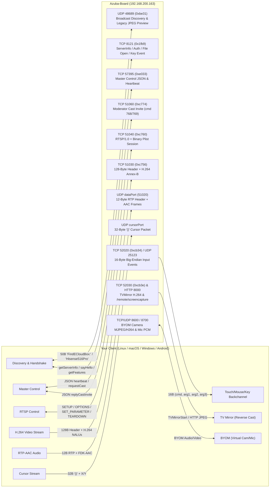

# Hisense Interactive Display (`MR6DE/WM6FE` & `108"/136"/163" HAIO` Series) Protocol Specification

> [!IMPORTANT]
> **Audio correction — 10 November 2026:** Video and Stop work on the tested board. The audio prototype produces sound, but the user subsequently reported distortion, crackling and choppy playback during a window test. Fresh native encoder analysis proves the earlier AAC-LC choice was wrong: the sender uses **AAC-ELD (AOT 39), stereo 44,100 Hz, 192 kbit/s, 480-sample granules**. The codec fix and physical retest are pending; audio quality is not qualified. Earlier picture/sound observations remain historical results, not a quality pass. No blanket support claim applies to all Hisense models, protected pairing, dynamic ports or other firmware.

## Follow-up — 10 November 2026: native route and Janus correction

### Evidence boundaries and artifact identity

The critical question was whether the advertised AirPlay endpoint and the native EShare mirror endpoint are interchangeable. They are separate in the inspected macOS sender. This pass re-read shipped native code, traced Janus's corresponding startup, reproduced the failure, and exercised the corrected route on the board. It did not execute the vendor macOS or Windows clients on their native OSes.

Fresh hashes and sizes were checked against the current extracted bytes:

| Artifact | Bytes | SHA-256 |
| --- | ---: | --- |
| macOS `EShareSDK` | 6,837,840 | `1e1e51a5dc5787a62fc7514e9359005588a723f1e0c185723520bd97625101ec` |
| Windows `ESSDK.exe` | 34,175,488 | `be4ef494d73e48afedd19829debec2f5e3cec8b0ccf6f8cc54b00fb9725bfbd5` |
| Windows `ESTXLibrary.dll` | 169,472 | `8588668b3daec2bed94aa5838fd427947451f9ba77f950ac5b44c41f9c6aa616` |

The old macOS size was wrong. The two Windows hashes differ from the original report; old Windows Evidence IDs must not be assumed to describe these bytes. The inventory below now records the current identities. Other historical inventory entries were not requalified by this focused pass.

The retained [REA evidence bundle](../research/hisense-rea-20261110.json) records actual tool outputs and their limitations. Windows file headers are Evidence `ev_b3bec5c66785dfd08859bd708ee0cdadf7fb3ca2782e9f537dfa0309076a8409`. REA's GNU objdump rejected the Mach-O format, rather than producing a call graph: `ev_b3fc4b1188e8900b70a0a3435c3a4de2d794de88675b3d23f9478f0e6c7ccae0`. The selected Windows exported-symbol disassembly returned no function body (`ev_011f7f6bb9e09d52bfe869631ff045c76f1d9a8d0e4cfd7805ecd09310f679a3`). Ghidra/Hopper deep analysis was unavailable. None of these results proves that the corresponding method or protocol is absent.

### macOS control flow: the port belongs to the protocol adapter

Separately from REA, shell LLVM objdump successfully decoded the macOS SDK. The selected methods are retained in [rtsp_routing_stop_20261110.txt](../research/extracted/overseas_mac/rtsp_routing_stop_20261110.txt). This is static disassembly evidence, with no invented REA identifier:

| Method/site | Observation | Implementation consequence |
| --- | --- | --- |
| `-[RTSPClient startMrror]`, `0xa3969` | Loads selector `getDynamicPort_51040` at `0xa39ce`; passes the result into socket connect at `0xa3a02` | Native EShare RTSP uses the 51040 service, independently of an AirPlay announcement on 51010 |
| `-[RTSPClient teardown]`, `0xa4f35` | Builds a binary-plist `streams` request containing video stream type 110 | Stop needs the EShare video teardown, with its response checked separately from local shutdown |
| `-[RTSPClient stopMirror]`, `0xa3c3c` | Calls teardown, then `disconnectAfterWriting` at `0xa3c89` | Native shutdown flushes the teardown write and disconnects; it does not wait for an RTSP acknowledgement |

The dynamic-port accessor is observed in native code; Janus does not thereby gain dynamic-port negotiation support. This correction targets the static-port profile actually exercised. Generic AirPlay routing must stay unchanged.

Windows corroborates protocol vocabulary in raw `ESSDK.exe` bytes: `getServerInfo` at file offset `0x121df68`, `getListenedPort` at `0x121e100`, `MacOSXStream` at `0x124bd44`, and `EShare (EShare 1.0)` at `0x1208340`. The [Windows anchor analysis](../research/extracted/overseas_win/essdk_protocol_anchors_20261110.txt) also maps PE sections and selected absolute-reference candidates using Python and GNU objdump, separately from REA. For example `getListenedPort` maps to VA `0x161f500`, with `.text` references at `0x7d5339` and `0x812379`; `MacOSXStream` is mapped too. File offsets and VAs are distinct. These candidates corroborate code references to the vocabulary, but do not recover a complete call graph or prove invocation order. Windows connection, authorization, and media control flow remains partially understood without deeper analysis or client traffic.

### Live observations and the reproduced failure

On the selected board, TCP 51010, 51040, 8000, 8121, 57395, and 51030 accepted connections. Port reachability alone does not qualify a protocol or authorize a security downgrade. A read-only HTTP HEAD on port 8000 returned `Server: EShare Http Server/1.0`, positive EShare-specific evidence. The `getServerInfo` request on 8121 timed out; a successful TCP connect must not be reported as a successful server-info exchange. RTSP OPTIONS on 51040 returned JSON encoder attributes, distinguishing it from the discovered AirPlay route.

The baseline Janus cast attempted video SETUP through discovered port 51010 and failed. Hisense startup reused that connection, then retried the same endpoint; the declared EShare 51040 constant did not determine its connection target. Routing the positively identified EShare profile to its own RTSP service removed that failure: a three-second test-pattern run transmitted 40 frames and exited successfully. The user explicitly confirmed the moving pattern on the panel and confirmed that physical sharing stopped. These are physical observations for one board, distinct from synthetic framing and negotiation tests.

The subsequent independent sweep transmitted 54 of 54 queued frames and failed only its receiver teardown acknowledgement check. Packet capture `/tmp/janus-hisense-stop2.pcapng` (temporary local evidence) shows TEARDOWN CSeq 5 in frame 18 and its body in frame 19, followed by receiver FIN in frame 21 with no RTSP response. The native `stopMirror` sequence above explains why waiting for an acknowledgement is an unsupported acceptance requirement for this path. FIN is connection closure, not an RTSP acknowledgement or proof of rendering.

Janus still sends the native video teardown before closing. Hisense shutdown now leaves receiver acknowledgement unknown, and acceptance reports **Pending**: local EShare stream/control closed; no RTSP teardown acknowledgement; confirm display stopped. This preserves the user's physical Stop confirmation without inventing an ACK. The final post-correction sweep exited 0 with 15/15 frames; authentication, rendering acknowledgement and teardown acknowledgement remain Pending. Physical observations and exact commands are in [validation](validation.md).

### Desktop behavior and remaining qualification

*(Superseded 10 November 2026: the switch was removed at the user's request; EShare boards are supported natively, still selected only by explicit EShare server identity.)* Originally the Settings → **Hisense interactive display (Alpha)** switch was reused. It was off by default, gated proprietary discovery/profile selection, and was session-only. Enabling it does not start capture. Casting still uses Janus's normal destination, source, Cast, and Stop flow; no vendor SDK is loaded. The initial routing fix was video-only; the later AAC prototype added sound but failed the user's subsequent audio-quality check. The codec correction below supersedes the initial AAC-LC implementation assumption. Active Settings copy now says unencrypted and use a trusted LAN. Explicitly unavailable audio still fails visibly before capture; the pipeline must not silently disable requested sound. The receiver card's Cast/Cancel/Stop action now occupies the far right of the same horizontal row as source, sound and resolution; the left controls may wrap on compact widths. EShare's unencrypted stream must not be described as successful FairPlay, HomeKit pairing, or verified receiver identity in acceptance output.

The earlier video-only build gates passed: desktop build through `scripts/build.sh`, rendered smoke result `JANUS_SMOKE_OK`, core/desktop Clippy and formatting, and workspace **176 passed, 0 failed, 8 ignored**. A five-second portal-selected screen cast also completed at 1920×1080 without sound, and the user confirmed desktop picture and Stop. Its 11-frame checkpoint and high encode lateness do not qualify smooth 1080p30; the planned frame rate is not measured performance. The user also confirmed the full rebuilt-GPUI alpha-switch, selection, Sound off, Cast and Stop flow. Window capture remains a separate check. See [validation](validation.md).

### AAC follow-up — 10 November 2026: sound negotiated on its own stream

The retained native methods in [audio_20261110.txt](../research/extracted/overseas_mac/audio_20261110.txt) were extracted with LLVM objdump from the same macOS SDK identified above. They are static binary evidence, separate from the saved REA tool results. The critical details are the negotiated port, raw codec framing and byte order:

| Native evidence | Observed behavior | Janus consequence |
| --- | --- | --- |
| `-[RTSPClient setupAudio]`, `0xa4c43` | Binary-plist `streams` entry uses `type=96`, `audioFormat=0x01000000` | Negotiate a separate AAC audio stream after video TCP is connected |
| `-[ESAudioSession RTPPackAndSend:withlen:]`, `0x32fb4` | Prefix `80 60`, big-endian sequence and millisecond timestamp | Use a 12-byte UDP header with the native millisecond clock, not AirPlay's sample clock |
| Store at `0x3306e` | Byte 8 receives `1`; remaining constant bytes are zero | Copy SSRC bytes **`01 00 00 00`** exactly; the original report's `00 00 00 01` was wrong |
| Same packet builder | Copies raw AAC bytes directly after the header | No ADTS wrapper or AAC AU-length header |
| `FdkAACEncoder` default constant at VA `0x1dbf80` | Bytes `0200000044ac000000ee020027000000` decode as little-endian u32 values: channels 2, rate 44100, bitrate 192000, AOT 39 | Native codec is AAC-ELD at 192 kbit/s; the initial AAC-LC/128-kbit/s choice was incorrect |
| `-[FdkAACEncoder initEncoder]`, store at `0x42ddb` | Sets granule length `0x1e0` = 480 before encoder parameter setup | Encode 480-sample granules, not AAC-LC's 1024-sample frames |

The board's actual audio SETUP response returned stream type 96 with `dataPort=54022` and `controlPort=54756`. These are one session's negotiated values, not fixed ports. Janus sends AAC to the returned `dataPort`; it does not invent a second control flow from `controlPort`, hardcode a UDP audio port, or reuse the legacy AirPlay ALAC/RTCP transport. Dynamic-port discovery for the initial control endpoint is a separate, still-unqualified capability.

The required path is desktop PipeWire monitor → 44,100-Hz stereo PCM → AAC-ELD (AOT 39) at 192 kbit/s with 480-sample granules → native EShare UDP packetizer. The first implementation instead used AAC-LC at 128 kbit/s with 1024-sample frames through GStreamer's libav encoder. That codec mismatch is established by the native constant and parameter setup, even though some sound was heard. The exact ELD encoder correction is in progress; its physical result is pending. The earlier libav runtime package additions and RPM Release 3 describe the first attempt, not proof of a compatible ELD encoder or a rebuilt RPM.

The first synthetic test in `crates/janus-encode/tests/test_aac.rs` decoded the AAC-LC output with `avdec_aac` using LC configuration and checked 44,100-Hz stereo 440/880-Hz separation. It proved that the chosen LC encoder could produce decodable LC; it did **not** establish the receiver's required AAC profile or native compatibility. Corrected proof must check AOT 39, 480-sample framing and actual receiver sound. Passing the old LC decoder test is insufficient.

The first live eight-second audio run used Janus test-pattern video plus the desktop monitor while `pw-play` played alternating left 440-Hz/right 660-Hz tones. Its last checkpoint reported 118 video frames and 253 queued audio packets; the process exited 0. The user explicitly confirmed board picture, sound and Stop. The later window test produced the user's explicit report of distorted, crackling, choppy sound, rather than merely an audio/video sync issue. Hearing the first tones does not qualify audio quality. Queue counts alone do not prove transmitted or audible packets, and this codec mismatch must be fixed and physically retested before claiming working sound.

Generic acceptance now adds a Hisense audio stage. Explicit mirror runs request audio only when the live capability supports it; read-only runs leave the stage Pending. Zero actual transmitted audio packets fail; a positive transmitted count remains Pending with “no audio playback ACK; confirm sound physically.” There is no invented playback acknowledgement. Audio-quality diagnosis and the ELD correction/retest now take priority over claiming repeat-sweep acceptance. The mismatch is a concrete defect; whether the corrected codec eliminates every reported artifact remains unverified. Exact later results belong in [validation](validation.md), [todo](todo.md), and [plan](plan.md).

| Investigation question | State | Boundary / next proof |
| --- | --- | --- |
| Can a native Janus adapter reach this board? | Answered | Corrected route delivered a physically confirmed moving test pattern |
| Why did the previous connection fail? | Answered | Janus reused 51010; macOS static flow selects EShare 51040; corrected live run succeeded |
| Are macOS and Windows implementations fully reconstructed? | Partially answered | Focused Mac routing/Stop decoded; Windows literals and headers only |
| Does Stop require an RTSP acknowledgement? | Answered for this path | Native flush-and-disconnect plus captured FIN/no response; user confirmed physical Stop; ACK remains unknown; final sweep exits 0 with Pending evidence |
| Does the Settings switch expose the existing adapter? | Answered in source and physically | User confirmed rebuilt GPUI alpha switch On → board selection → Sound off → Cast → Stop; portal-selected CLI desktop also confirmed |
| Does native AAC sound meet playback-quality acceptance? | Failed for initial implementation; correction in progress | First tones were heard, but user reported distorted/crackling/choppy window audio; native ELD/480/192k mismatch identified; physical retest pending |
| Are all listed Hisense models, PIN-protected boards, and dynamic ports supported? | Unresolved | Require separate protocol implementation and physical acceptance per capability |
| Is proprietary broadcast discovery fully matched to the native sender? | Partially answered | Original 50-byte layout description is retained research, not a newly validated byte contract; parser and native packet layout need separate reconciliation |

The original sections below are a research ledger containing static observations, inferences, and illustrative snippets. “Complete” or “verified” in those sections must not be read as product-wide qualification. In particular, the Python sketch is not production code or a tested replacement for Janus's Rust lifecycle.

---

## 1. Shipped Artifact Inventory & REA Evidence Ledger

All binaries analyzed below were downloaded directly from the **MR6DE/WM6FE Series & 108"/136"/163" HAIO Series** section of `https://www.hisense-b2b.com/en/downloads` (plus the companion `TS_ScreenShare_Mac.pkg` build containing unstripped Objective-C symbols for `EShareSDK`):

| Platform | Shipped Artifact & Extracted Binaries | Size (Bytes) | SHA-256 | REA Evidence IDs |
| :--- | :--- | :---: | :--- | :--- |
| **Android** | [overseas_ScreenShare_Android.apk](file:///home/sapategu/works/janus/research/artifacts/overseas_ScreenShare_Android.apk) (`com.hisense.screenshare`, v2.21.11.0915) | `24,271,860` | `ad37b5bb8cb7234ec6ff5f265211be735035d72076ee3e9c1569607a46bf3eb9` | `ev_7739b216ede31d7b7ef6f42dc0ef63b0e7070c9690a89c3dabad384178d0bd99` (`inspect_apk_signature`)<br>`ev_44001ceb060ba565134d0e69a638253e4edd1d1c97e6d36e9cac9979af2a7e7c` (`inspect_artifact`)<br>`ev_39acab6744b867643fc213ca9e0f618ae47392ef3e1d418f6883b9f0ff2f8822` (`extract_artifact`) |
| **Android JNI** | [libsharemax.so](file:///home/sapategu/works/janus/research/extracted/overseas_android/lib/arm64-v8a/libsharemax.so)<br>[libscannative.so](file:///home/sapategu/works/janus/research/extracted/overseas_android/lib/arm64-v8a/libscannative.so) | `428,432`<br>`13,384` | `7b64a02c28ce85f6e8d51b2b346f85cf4179ae62ae036e8235327762a2a89855`<br>`8562b4d91326c8c383721fa23db85399c30a0b750a69dc13e146fb1a9a9cb8c1` | `ev_f39d0f0d02bca4262218bc4469f8cc5eb9351db9712297f18ec74ae30ce24dae` (`inspect_native_exports`)<br>`ev_9c7c06fd43daa92289ebc2ab7e281b4b9197325467509fbb91fe0c61ed42f602` (`inspect_native_exports`) |
| **Windows** | [overseas_ScreenShare_Win.exe](file:///home/sapategu/works/janus/research/artifacts/overseas_ScreenShare_Win.exe) (Inno Setup 6.0.5 installer) | `33,689,080` | `d150f7819d3186d22156d3630c23a104c32197b48c473dc4964440e1a0469dcf` | Extracted via custom Inno Setup LZMA + BCJ decoder to [extracted/overseas_win/files/](file:///home/sapategu/works/janus/research/extracted/overseas_win/files/) |
| **Windows PE** | [ScreenShare.exe](file:///home/sapategu/works/janus/research/extracted/overseas_win/files/ScreenShare.exe)<br>[ESSDK.exe](file:///home/sapategu/works/janus/research/extracted/overseas_win/files/ESSDK.exe)<br>[ESTXDemo.exe](file:///home/sapategu/works/janus/research/extracted/overseas_win/files/ESTXDemo.exe)<br>[ESTXLibrary.dll](file:///home/sapategu/works/janus/research/extracted/overseas_win/files/ESTXLibrary.dll) | `1,619,880`<br>`34,175,488`<br>`151,552`<br>`169,472` | `5f9c72f969b64234434fca9beaeb7a7be284784dafaac9019b161309972932a3`<br>`be4ef494d73e48afedd19829debec2f5e3cec8b0ccf6f8cc54b00fb9725bfbd5`<br>`f74b86ff44b04880304a5ba4f2a7191514fae409519b200d0b8513c65cd54fea`<br>`8588668b3daec2bed94aa5838fd427947451f9ba77f950ac5b44c41f9c6aa616` | `ev_d7651e31f8a3a64bd7d3fb06c07abd395f0c83a1966f1153324cca75dc4317cd` (`inspect_pe_imports`)<br>`ev_a8564aef75d56c756a262f817b4ec02d8ef1860f197e1b7d041adfbaea95e14b` (`inspect_pe_imports`)<br>`ev_25b4b8afecd80bce2053ce09de023ced598d8f1a627773666333704307778d6b` (`inspect_pe_imports`)<br>`ev_1a92c5227d1292a38de35b94a703b335a68ae5e84c3a3d66f3ca05e569432654` (`inspect_native_exports`) |
| **macOS** | [overseas_ScreenShare_Mac.pkg](file:///home/sapategu/works/janus/research/artifacts/overseas_ScreenShare_Mac.pkg) -> [ScreenShare](file:///home/sapategu/works/janus/research/extracted/overseas_mac/app/ScreenShare.app/Contents/MacOS/ScreenShare) & [EShareSDK](file:///home/sapategu/works/janus/research/extracted/overseas_mac/app/ScreenShare.app/Contents/Frameworks/EShareSDK.framework/Versions/A/EShareSDK) | `4,553,107`<br>`3,262,848`<br>`6,837,840` | `e3413d20df2038d200f87d7d0ee8e073012dd8c9b8b846a98b3a4dc24800416f`<br>`2e422b5dcedd9448511efb2bbd7822f88da0701e59eb79b48da6d29698b8c30f`<br>`1e1e51a5dc5787a62fc7514e9359005588a723f1e0c185723520bd97625101ec` | `ev_6d2ce45effe8c564dfaabce54690c521b6f3e017ac48d4f1d0a80531acfd3e85` (`trace_dylib_resolution`) |

### Disassembly & Bytecode Reference Files
- **Android Dalvik Bytecode**: [dex_key_methods.txt](file:///home/sapategu/works/janus/research/extracted/overseas_android/dex_key_methods.txt) (`HisenseQRActivity`, `EShareService`, `MirrorManager`, `MirrorThread`, `CaptureImageService`, `RemoteControlActivity`).
- **macOS `EShareSDK` Disassembly (Discovery, PIN, Handshake)**: [eshare_part1_discovery_pin_auth.txt](file:///home/sapategu/works/janus/research/extracted/ts_mac/eshare_part1_discovery_pin_auth.txt) & [overseas_eshare_part1.txt](file:///home/sapategu/works/janus/research/extracted/overseas_mac/overseas_eshare_part1.txt).
- **macOS `EShareSDK` Disassembly (RTSP, Video, Audio, Touch, BYOM)**: [eshare_part2_media_control_byom.txt](file:///home/sapategu/works/janus/research/extracted/ts_mac/eshare_part2_media_control_byom.txt).
- **Windows Native Disassembly**: [ESTXLibrary_disasm.txt](file:///home/sapategu/works/janus/research/extracted/overseas_win/ESTXLibrary_disasm.txt) & [ScreenShare_strings.txt](file:///home/sapategu/works/janus/research/extracted/overseas_win/ScreenShare_strings.txt).

---

## 2. Decoding Your Live QR Code (`Azuba-Board`)

Your Hisense interactive display generated the following QR code URL:
```text
https://commercial-display.hisense.com/download/hs?ip=192.168.200.163:8000&LocationIP=192.168.200.163&ops_address=0.0.0.0&LANCast=true&isAp=false&devicename=Azuba-Board&sn=0x1001bf&ssid=AZUBA-5G&Registered=true
```

### 2.1 How `HisenseQRActivity` Parses the QR Code
In [dex_key_methods.txt](file:///home/sapategu/works/janus/research/extracted/overseas_android/dex_key_methods.txt#L4801-L4974) (`HisenseQRActivity.onActivityResult`), the app parses the query parameters in strict order by splitting on `&` and `=`:

| Query Parameter | Value on `Azuba-Board` | Exact Handler Logic in `HisenseQRActivity` |
| :--- | :--- | :--- |
| `ip` | `192.168.200.163:8000` | Splits on `:` (`ip.split(":")[0]`) -> `scanIp = "192.168.200.163"`. The `:8000` suffix is the board's HTTP remote capture server (`http://192.168.200.163:8000/remote/screencapture`). |
| `LocationIP` | `192.168.200.163` | Validated via `isValidIP(locationIp)`. When valid (`!= "0.0.0.0"`), **overrides** `scanIp` (`this.scanIp = this.locationIp`). |
| `ops_address` | `0.0.0.0` | Pluggable OPS Windows PC module IP (`0.0.0.0` = no OPS module active or not bridged). |
| `LANCast` | `true` | Stored in `this.lanCast`; indicates LAN casting is enabled across `LocationIP`. |
| `isAp` | `false` | Checked via `Boolean.parseBoolean(isAp)`. Because `isAp == false` and `locationIp` is valid, the app skips Wi-Fi AP switching (`connectWifiAp`) and immediately connects over LAN to `192.168.200.163`! |
| `devicename` | `Azuba-Board` | URL-decoded via `URLDecoder.decode(val, "UTF-8")` and stored as display name. |
| `sn` | `0x1001bf` | Parsed via `Integer.decode("0x1001bf")` = **`1049023` (`0b0001_0000_0000_0001_1011_1111`)**. Despite the key name `sn`, this is the **Server Feature Bitmask (`mServerFeatures`)**! |
| `ssid` | `AZUBA-5G` | Wi-Fi network SSID the display is connected to (`URLDecoder.decode`). |
| `Registered` | `true` | Indicates the display's EShare license is activated (`register_status == true`). |

### 2.2 Complete Bitmask Breakdown of `sn=0x1001bf` (`0x001001BF`)
Cross-referencing `ESConnectPack::connectCheck` ([eshare_part1_discovery_pin_auth.txt](file:///home/sapategu/works/janus/research/extracted/ts_mac/eshare_part1_discovery_pin_auth.txt#L938-L1155)), `DevicesManager::parseDataWithSplit:ip:` ([eshare_part1_discovery_pin_auth.txt](file:///home/sapategu/works/janus/research/extracted/ts_mac/eshare_part1_discovery_pin_auth.txt#L1867-L1958)), and `RTSPClient::updateEncoderAttribute:beforeConnect:` ([eshare_part2_media_control_byom.txt](file:///home/sapategu/works/janus/research/extracted/ts_mac/eshare_part2_media_control_byom.txt#L17056-L17080)):

| Bit(s) | Hex Mask | Value in `0x1001bf` | Method / Symbol | Meaning for `Azuba-Board` |
| :---: | :---: | :---: | :--- | :--- |
| **Bit 0** | `0x00000001` | **`1`** | `updateEncoderAttribute:beforeConnect:` | **Dynamic Encoder Attribute Support**: Board returns target resolution (`casting_win_width`/`height`), `Framerate`, `bitrate`, `i-interval`, and `idr_req` in RTSP `SETUP` and `OPTIONS` responses. |
| **Bits 1–5** | `0x0000003E` | **`11111₂`** | `mServerFeatures` | Standard EShare media streaming, screen mirroring, and remote control capabilities enabled. |
| **Bit 6** | `0x00000040` | **`0`** | `setHasPsw:` (`(f >> 6) & 1`) | **No Connection Password/PIN Required**: Client can connect and cast directly without `CHECKPASSWORD`. |
| **Bit 7** | `0x00000080` | **`1`** | `mServerFeatures` | Extended casting / multi-screen capability flag enabled. |
| **Bit 8** | `0x00000100` | **`1`** | `setIsTVversion:` (`bt $8, %edx`) | **Pro Commercial Board (`rx is pro ver`)**: Bit 8 = `1` sets `isTvVersion = 0`, enabling Pro multi-window casting (`requestCast: 7/8`) and Master Control (`57395`). |
| **Bit 9** | `0x00000200` | **`0`** | `setIsWindowsVersion:` (`f & 0x200`) | **Android/Linux Board OS (`rx is not windows`)**: Indicates the receiver runs Android rather than the Windows receiver app. |
| **Bit 20** | `0x00100000` | **`1`** | `setIsSupportHostPreviewV2:` (`bt $20`) | **Host Preview V2 (`TVMirrorPlayManager`)**: Board supports real-time H.264 reverse mirroring over **TCP port `52030`** (`TVMirrorStart\r\n0\r\n`). |
| **Bit 28** | `0x10000000` | **`0`** | `setIsSupportDynamicPort:` (`bt $28`) | **Static Default Ports (`rx nonsupportDynamicPort`)**: Board uses standard fixed ports (`8121`, `51040`, `51030`, `51060`, `52020`, `52030`, `57395`) rather than `getListenedPort`. |

---

## 3. Complete Port & Service Map of `Azuba-Board` (`192.168.200.163`)



---

## 4. Discovery & PIN-to-IP Decoding Algorithms

### 4.1 UDP Broadcast Discovery (Port `48689` / `0xbe31`)
Verified in [`-[DevicesManager sendBroadcastPacket]`](file:///home/sapategu/works/janus/research/extracted/ts_mac/eshare_part1_discovery_pin_auth.txt#L1701-L1764) and [`HisenseQRActivity.sendPacket`](file:///home/sapategu/works/janus/research/extracted/overseas_android/dex_key_methods.txt#L5028-L5087):
- **Request Packet**: Exactly **50 bytes (`0x32`)** sent to `<subnet_broadcast>:48689` and `255.255.255.255:48689`:
  - Bytes `0..14`: `0x00`
  - Byte `15`: `0x0e` (`14`)
  - Bytes `16..19`: `0x00`
  - Bytes `20..33`: ASCII `"FindECloudBox:"` (macOS/Windows) or `"Hisense516Pro\0"` (Android `overseas_ScreenShare_Android.apk`)
  - Bytes `34..49`: `0x00`
- **Reply Packet** (received on UDP port `48689`, parsed in [`-[DevicesManager parseDataWithSplit:ip:]`](file:///home/sapategu/works/janus/research/extracted/ts_mac/eshare_part1_discovery_pin_auth.txt#L1808-L1974)):
  - Bytes `20..N` contain a colon-delimited string split on `":"`: `Prefix : DeviceName : Port : Reserved3 : Reserved4 : ServerFeaturesHex : FpsHex`
  - Field `[1]` = `DeviceName` (`Azuba-Board`)
  - Field `[2]` = Service Port
  - Field `[5]` = `ServerFeaturesHex` (`0x1001bf`), parsed via `strtoul(field5, 0, 16)`
  - Field `[6]` = `FpsHex`, parsed via `strtoul(field6, 0, 16)`

### 4.2 Complete PIN-to-IP Decoding Algorithms (`PinCode` Class)
When a user enters a 6-digit, 8-digit, 6-letter, or 8-letter PIN displayed on the Hisense screen, the client deterministically computes the board's IPv4 address without needing UDP broadcast! Extracted from [`PinCode`](file:///home/sapategu/works/janus/research/extracted/ts_mac/eshare_part1_discovery_pin_auth.txt#L7709-L8705):

1. **6-Digit Numeric PIN (`+[PinCode sixNumberPinToIP:]`, lines 8496–8586)**: $$\text{val} = 999999 - \text{int}(\text{pin}) \quad (\text{where } 999999 = \text{0xF423F})$$
   - If $\text{val} \le 65536$ (`0x10000`):
     - $\text{octet}_3 = (\text{val} \gg 8) \ \& \ \text{0xFF}$
     - $\text{octet}_4 = \text{val} \ \& \ \text{0xFF}$
     - Combines with the client's own local IP's first two octets: `f"{local_ip.split('.')[0]}.{local_ip.split('.')[1]}.{octet3}.{octet4}"`.

2. **8-Digit Numeric PIN (`+[PinCode eightNumberPinToIP:]`, lines 8587–8685)**: $$\text{val} = (99999999 - \text{int}(\text{pin})) \oplus 57395 \quad (\text{where } 99999999 = \text{0x5F5E0FF}, \ 57395 = \text{0xE033})$$
   - Checks $\text{val} \le 16777216$ (`0x1000000`):
     - $\text{octet}_2 = (\text{val} \gg 16) \ \& \ \text{0xFF}$
     - $\text{octet}_3 = (\text{val} \gg 8) \ \& \ \text{0xFF}$
     - $\text{octet}_4 = \text{val} \ \& \ \text{0xFF}$
     - Combines with the client's first IP octet: `f"{local_ip.split('.')[0]}.{octet2}.{octet3}.{octet4}"`.

3. **6-Character Alphabetic PIN (`+[PinCode Char6ToIP:]`, lines 7915–8092)**:
   - Uppercase `A–Z` base-26 decoding (`all6CharComb = 26^6 = 308,915,776 = 0x1269AE40`): $$\text{num} = \sum_{i=0}^{5} (\text{ord}(c_i) - 65) \times 26^{5 - i}, \quad \text{ip\_val} = 308915775 - \text{num}$$
   - Extracts 3 octets (`octet2 = (ip_val >> 16) & 0xFF`, `octet3 = (ip_val >> 8) & 0xFF`, `octet4 = ip_val & 0xFF`) and prepends the local class-A octet.

4. **8-Character Alphabetic PIN (`+[PinCode eightCharPinToIP:]`, lines 8276–8495)**:
   - Uppercase `A–Z` base-26 decoding (`allCharComb = 26^8 = 208,827,064,576`, `allIPComb = 256^4 = 4,294,967,296`): $$\text{num} = \sum_{i=0}^{7} (\text{ord}(c_i) - 65) \times 26^{7 - i}, \quad \text{ip\_val} = (208827064575 - \text{num}) \bmod 4294967296$$
   - Extracts all 4 IPv4 octets directly: `f"{(ip_val >> 24) & 0xFF}.{(ip_val >> 16) & 0xFF}.{(ip_val >> 8) & 0xFF}.{ip_val & 0xFF}"`.

---

## 5. Handshake, Authentication & Master Control Protocols

### 5.1 TCP Port `8121` (`0x1fb9`) Control & Auth Commands
Verified in [`ESConnectPack`](file:///home/sapategu/works/janus/research/extracted/ts_mac/eshare_part1_discovery_pin_auth.txt#L844-L1638) and [`HisenseQRActivity$11`](file:///home/sapategu/works/janus/research/extracted/overseas_android/dex_key_methods.txt#L4460-L4677). Every command opens a short-lived TCP connection to `192.168.200.163:8121`:

| Operation | Exact Request Payload (`\r\n` delimited) | Response Format |
| :--- | :--- | :--- |
| **Get Server Info** | `getServerInfo\r\n1\r\n\r\n` | JSON object containing `deviceName`/`devicename`/`name`, `feature` (int/hex), `extraInfo` (`{"byom": 1/2}`), `android_ip`, `ops_ip`, `currentSource`, `register_status`. |
| **Get Dynamic Ports** | `getListenedPort\r\n1\r\n\r\n` | JSON object mapping `"51010"`, `"51020"`, `"51030"`, `"51040"`, `"52020"`, `"52025"`, `"52030"` to dynamic port integers (only used if bit 28 of `feature` is set; `Azuba-Board` has bit 28 = `0`). |
| **Get Password Config** | `GETPASSWORDCONFIG\r\neshare\r\n\r\n` | Returns password/PIN requirement status. |
| **Check Password / PIN** | `CHECKPASSWORD\r\n<password>\r\n\r\n` | Returns string containing `"check success"` on valid PIN/password. |
| **Client Hello** | `sayHello\r\n<ModelName>EShareClient\r\n\r\n` | Registers client device name with receiver. |
| **Query Features** | `getFeatures\r\n<ModelName>EShareClient\r\n\r\n` | Returns feature string (`cast_type`, `server_version`, etc.). |
| **Remote Key Event** | `keyEvent\r\n<keycode>\r\n\r\n` | Injects Android KeyEvent (`3` = Home, `4` = Back, `24` = Vol+, `25` = Vol-, `82` = Menu). |
| **Cast Local Media URL** | `auth\r\n<encodedPath> <httpPort> onelong\r\n\r\n` followed by `Openfile\r\nOpen <encodedPath> <mimeType>\r\n\r\n` | Tells the board to fetch and play media from the client's local HTTP server (`http://<client_ip>:56000/<path>`). |

### 5.2 Master Control Socket (TCP Port `57395` / `0xe033` & TCP Port `51060` / `0xc774`)
Verified in [`ESMasterControlPack`](file:///home/sapategu/works/janus/research/extracted/ts_mac/eshare_part1_discovery_pin_auth.txt#L5042-L5809) and [`MirrorManager`](file:///home/sapategu/works/janus/research/extracted/overseas_android/dex_key_methods.txt#L8250-L8550):
- **Persistent Connection to `192.168.200.163:57395`**:
  - **Heartbeat (every 1.0s)**: Client sends `{"heartbeat": <counter>}` (or receives `{"heartbeat": ...}` and replies `{"replyHeartbeat": <counter>}`).
  - **Client Info Query**: When the server sends a JSON packet containing `"clientInfo"`, the client replies:
    ```json
    {"clientName": "MyHost", "clientType": 3, "version": 1, "castState": 1, "isTouchControl": 1}
    ```
    *(Note: `clientType` = `3` for macOS, `2` for Windows, `0`/`1` for Android/iOS)*.
  - **Request Cast / Fullscreen**:
    - Request normal/split cast: `{"requestCast": 7}`
    - Request fullscreen cast: `{"requestCast": 8}`
    - Exit fullscreen: `{"exitFullscreen": "N"}` (or `{"exitFullscreen": 0}` on Android)
    - Disconnect notification: `{"disconnect": "N"}`
- **Cast Invitation / Moderator Control (TCP Port `51060` / `0xc774`)**:
  - Server sends `{"command": 768}` (invite to cast) or `{"command": 769}` (stop cast); client replies `{"replyCastInvite": 1}` (accept) or `{"replyCastInvite": 0}` (decline).

---

## 6. Screen Mirroring Protocol (RTSP + Binary Plist + H.264 + AAC)

### 6.1 RTSP Control Session on TCP Port `51040` (`0xc760`)
Verified in [`RTSPClient`](file:///home/sapategu/works/janus/research/extracted/ts_mac/eshare_part2_media_control_byom.txt#L14692-L17260). The client connects to `192.168.200.163:51040` with `TCP_NODELAY = 1`.

Every RTSP request is formatted by [`-[RTSPClient cmdDataSimpleWithCommand:body:]`](file:///home/sapategu/works/janus/research/extracted/ts_mac/eshare_part2_media_control_byom.txt#L15628-L15800):
```http
<COMMAND> rtsp://192.168.200.163 RTSP/1.0\r\n
CSeq: <cseq>\r\n
Content-Length: <body_byte_length>\r\n
User-Agent: EShare (EShare 1.0)\r\n
\r\n
<binary_body>
```

#### Step 1: `SETUP` Video (`tag = 1`, [`-[RTSPClient setupVideo]`](file:///home/sapategu/works/janus/research/extracted/ts_mac/eshare_part2_media_control_byom.txt#L15862-L16058))
- **Command**: `SETUP`
- **Body**: An **Apple Binary Property List (`NSPropertyListBinaryFormat_v1_0` = `200` / `bplist00`)** serialized from the following dictionary:
  ```python
  {
      "streams": [
          {
              "type": 110,  # 0x6e (Video stream type)
              "MacOSXStream": True,  # Boolean true
              "machine_name": b"MyClientName",  # UTF-8 bytes (NSData) of hostname
              "showKeyboardMenu": True,  # Boolean true
              "extend_screen": 0,  # 0 = main screen, 1 = extended/window
          }
      ]
  }
```
- **Server Response (`tag = 1`)**:
  - `RTSP/1.0 200 OK\r\n...\r\nContent-Length: <len>\r\n\r\n<bplist_or_json_body>`
  - Parsed in [`-[RTSPClient updateEncoderAttribute:beforeConnect:]`](file:///home/sapategu/works/janus/research/extracted/ts_mac/eshare_part2_media_control_byom.txt#L17033-L17240). Because `Azuba-Board` has `feature & 1 == 1` (`0x1001bf`), the response body is a Binary Plist containing target encoder parameters:
    - `feature`: Server feature bitmask (`0x1001bf`)
    - `casting_win_width`: Target video width (e.g., `1920`)
    - `casting_win_height`: Target video height (e.g., `1080`)
    - `Framerate`: Target FPS (e.g., `30`)
    - `bitrate`: Target bitrate in bps
    - `i-interval`: Keyframe interval in seconds
    - `idr_req`: `1` if immediate IDR frame is requested
- **Action Upon Receiving `tag = 1` Response**:
  1. Start Video Session on **TCP port `51030`** (`[mVideoSession startMrror]`).
  2. Start Touch/Mouse/Key Backchannel on **TCP port `52020`** (`[mRemoteController startController]`).
  3. Send `SETUP` Audio (`[self setupAudio]`).

#### Step 2: `SETUP` Audio (`tag = 2`, [`-[RTSPClient setupAudio]`](file:///home/sapategu/works/janus/research/extracted/ts_mac/eshare_part2_media_control_byom.txt#L16059-L16207))
- **Command**: `SETUP`
- **Body**: Binary Plist (`bplist00`):
  ```python
  {
      "streams": [
          {
              "type": 96,  # 0x60 (Audio stream type)
              "audioFormat": 16777216,  # 0x01000000
          }
      ]
  }
```
- **Server Response (`tag = 2`)**:
  - Binary Plist containing `{"streams": [{"dataPort": <udp_audio_port>}]}` (typically `51020`).
  - Client starts `ESAudioSession` sending RTP-AAC packets to `192.168.200.163:<dataPort>`.

#### Step 3: `SET_PARAMETER` (`tag = 5`, [`-[RTSPClient setParameter]`](file:///home/sapategu/works/janus/research/extracted/ts_mac/eshare_part2_media_control_byom.txt#L16309-L16358)) & Keepalive `OPTIONS` (`tag = 3`, [`-[RTSPClient optinos]`](file:///home/sapategu/works/janus/research/extracted/ts_mac/eshare_part2_media_control_byom.txt#L16278-L16308))
- `SET_PARAMETER` adds extra RTSP headers (`AspectRatio: 0\r\n` or `1\r\n`, and `PPTSlideShow: 0\r\n` or `1\r\n`) with no body.
- Every ~1–2 seconds, the client sends `OPTIONS rtsp://192.168.200.163 RTSP/1.0\r\nCSeq: <n>\r\nUser-Agent: EShare (EShare 1.0)\r\n\r\n` (`tag = 3`).
- If the server's `OPTIONS` response includes a JSON body (`Content-Length > 0`), [`-[RTSPClient checkChangeEncoderAttribute:]`](file:///home/sapategu/works/janus/research/extracted/ts_mac/eshare_part2_media_control_byom.txt#L16841-L17032) dynamically updates `casting_win_width`, `casting_win_height`, `Framerate`, `bitrate`, `i-interval`, or triggers an IDR frame (`idr_req == 1`)!

#### Step 4: `TEARDOWN` (`tag = 4`, [`-[RTSPClient teardown]`](file:///home/sapategu/works/janus/research/extracted/ts_mac/eshare_part2_media_control_byom.txt#L16208-L16277))
- Sends `TEARDOWN` with Binary Plist body `{"streams": [{"type": 110}]}`.

---

### 6.2 Video Stream Framing on TCP Port `51030` (`0xc756`)
Verified across all three platforms:
- macOS: [`-[VideoDisplaySession sendBytes:Bytes:]`](file:///home/sapategu/works/janus/research/extracted/ts_mac/eshare_part2_media_control_byom.txt#L7535-L7782) & [`-[VideoDisplaySession packetizeSPS_PPS:]`](file:///home/sapategu/works/janus/research/extracted/ts_mac/eshare_part2_media_control_byom.txt#L7146-L7356)
- Android: [`MirrorThread$VideoEncoderThread.run`](file:///home/sapategu/works/janus/research/extracted/overseas_android/dex_key_methods.txt#L10590-L10910)

Every H.264 access unit (or SPS/PPS configuration block) sent over **TCP port `51030`** is prefixed with a **128-byte (`0x80`) binary header**:

| Byte Offset | Type | Endianness | Value / Meaning |
| :---: | :---: | :---: | :--- |
| `0..3` | `uint32` | Little-Endian | **`payload_length`**: Exact byte length of the following H.264 Annex-B data. |
| `4..5` | `uint16` | Little-Endian | **`frame_type`** (macOS RTSP mode):<br>• `0x0100` (`256`): SPS + PPS parameter sets (`00 00 00 01 <SPS> 00 00 00 01 <PPS>`)<br>• `0x0101` (`257`): Standard unencrypted H.264 slice (`00 00 00 01 <NALU>`)<br>• `0x0103` (`259`): Safe-mode encrypted H.264 slice<br>*(Note: Android standalone `MirrorThread` writes `0x0000` at bytes `4..5` and puts `0x00` = config / `0x01` = frame at byte `4`)* |
| `6..7` | `uint16` | Little-Endian | `0x0000` (Reserved). |
| `8..11` | `uint32` | Little-Endian | **`ts_usec`**: Timestamp fractional part / microseconds (or `pts & 0xFFFFFFFF` on Android). |
| `12..15` | `uint32` | Little-Endian | **`ts_sec`**: Timestamp seconds (or `(pts >> 32) & 0xFFFFFFFF` on Android). |
| `16..19` | `uint32` | Little-Endian | `0x00000000` on macOS (`0x00000001` on Android `MirrorThread`). |
| `20..127` | `uint8[108]` | — | Zero padding (`0x00` * 108) so the header is always **128 bytes (`0x80`)**. |
| `128..128+N` | `uint8[N]` | — | **H.264 Annex-B Payload**: Every NALU is prefixed with the 4-byte start code `00 00 00 01` (`0x01000000` in little-endian memory). |

> [!TIP]
> **Critical Implementation Detail**: When `initWithCMSampleBuffer:` ([eshare_part2_media_control_byom.txt](file:///home/sapategu/works/janus/research/extracted/ts_mac/eshare_part2_media_control_byom.txt#L7357-L7534)) encodes an IDR keyframe (`isKeyFrame`), it **first** sends a 128-byte-framed `0x0100` packet containing `00 00 00 01 <SPS> 00 00 00 01 <PPS>`, and **immediately** follows it with a 128-byte-framed `0x0101` packet containing the IDR slice (`00 00 00 01 <IDR_NALU>`). Always send SPS/PPS with type `0x0100` before every keyframe!

---

### 6.3 Audio Streaming on UDP `dataPort` (`51020`)
Verified in [`-[ESAudioSession RTPPackAndSend:withlen:]`](file:///home/sapategu/works/janus/research/extracted/ts_mac/eshare_part2_media_control_byom.txt#L3819-L3900):
- **Codec — corrected 10 November 2026**: **AAC-ELD (AOT 39), 44,100 Hz, stereo, 192 kbit/s, 480-sample granules**. The native `FdkAACEncoder` default constant at VA `0x1dbf80` and granule store at `0x42ddb` are retained in [audio_20261110.txt](../research/extracted/overseas_mac/audio_20261110.txt). The original AAC-LC/1024-sample description was incorrect and caused an incompatible initial implementation.
- **Framing**: Each raw AAC frame is prefixed with a **12-byte (`0x0c`) RTP header** and sent via UDP to `192.168.200.163:<dataPort>`:
  - Byte `0`: `0x80` (RTP v2)
  - Byte `1`: `0x60` (Payload Type `96` = dynamic AAC)
  - Bytes `2..3`: Big-endian `uint16` sequence number (`seqno++`)
  - Bytes `4..7`: Big-endian `uint32` millisecond timestamp
  - Bytes `8..11`: **`0x01, 0x00, 0x00, 0x00`** (native constant `1` stored little-endian; corrected by the 10 November disassembly at `0x3306e`, not a big-endian SSRC of `1`)
  - Bytes `12..12+len`: Raw AAC-ELD access unit bytes, with no ADTS or AU-length wrapper.

---

### 6.4 Hardware Cursor Stream on UDP `cursorPort`
Verified in [`-[CursorSession moveToPoint:isVisible:ip:port:]`](file:///home/sapategu/works/janus/research/extracted/ts_mac/eshare_part2_media_control_byom.txt#L2859-L2920):
- Sends a **32-byte (`0x20`) UDP datagram**:
  - Bytes `0..1`: `0x29, 0x29` (ASCII `"()"`)
  - Bytes `2..3`: `0x00, 0x00`
  - Byte `4`: `isVisible` (`1` = visible, `0` = hidden)
  - Bytes `5..7`: `0x00, 0x00, 0x00`
  - Bytes `8..11`: Little-endian `int32` cursor X coordinate
  - Bytes `12..15`: Little-endian `int32` cursor Y coordinate
  - Bytes `16..31`: Zero padding (`0x00` * 16)

---

## 7. Reverse Mirroring ("TV Mirror" / Host Preview) & Touch Backchannel

### 7.1 Receiving the Board's Screen (`TVMirror` & HTTP Screen Capture)
Your `Azuba-Board` (`sn=0x1001bf`) supports **two** methods for viewing the board's screen on your client:

1. **Host Preview V2 (`TVMirrorPlayManager` on TCP Port `52030` / `0xcb3e`, [eshare_part2_media_control_byom.txt](file:///home/sapategu/works/janus/research/extracted/ts_mac/eshare_part2_media_control_byom.txt#L13992-L14690))**:
   - Enabled because Bit 20 (`0x100000`) of `sn=0x1001bf` is `1`.
   - Connect TCP to `192.168.200.163:52030`.
   - Send ASCII command:
     ```text
     TVMirrorStart\r\n0\r\n
     ```
   - The board immediately streams H.264 video frames back over the same TCP socket (`52030`)!
   - To stop, send:
     ```text
     TVMirrorStop\r\n0\r\n
     ```

2. **HTTP JPEG Polling (`CaptureImageService` on TCP Port `8000`, [dex_key_methods.txt](file:///home/sapategu/works/janus/research/extracted/overseas_android/dex_key_methods.txt#L3130-L3260))**:
   - Explaining why your QR code has `ip=192.168.200.163:8000`: the Android app's `CaptureImageService` polls:
     ```http
     GET http://192.168.200.163:8000/remote/screencapture HTTP/1.1
     ```
     every 150ms (`ConnectTimeout = 1000ms`, `ReadTimeout = 1500ms`) to receive a full-screen JPEG snapshot of the board!

3. **Legacy UDP Host Preview (`HostPreviewManager` on UDP Port `48689` / `0xbe31`, [eshare_part2_media_control_byom.txt](file:///home/sapategu/works/janus/research/extracted/ts_mac/eshare_part2_media_control_byom.txt#L13508-L13991))**:
   - Sends a 50-byte UDP datagram to `192.168.200.163:48689` with `0x0c` at offset `12` and `"getScreenCap"` at offset `20`, reassembling incoming UDP chunks between JPEG SOI (`FF D8`) and EOI (`FF D9`) markers.

---

### 7.2 Touch, Mouse & Keyboard Backchannel (TCP Port `52020` & UDP Port `25123`)

#### Direction A: Board -> Client (Receiving Touch/Keyboard from the Board While Casting)
Verified in [`-[RemoteController didReceiveData:]`](file:///home/sapategu/works/janus/research/extracted/ts_mac/eshare_part2_media_control_byom.txt#L1027-L1291):
- The client connects TCP to `192.168.200.163:52020` (`0xcb34`).
- Whenever someone touches the Hisense display while your screen is cast, the board sends **16-byte (`0x10`) packets** consisting of 4 big-endian `int32` values (`>iiii`: `cmd`, `arg1`, `arg2`, `arg3`):

| `cmd` (`int32` BE) | `arg1` (`int32` BE) | `arg2` (`int32` BE) | Meaning in `RemoteController` |
| :---: | :--- | :--- | :--- |
| **`1`** | Keycode (or `0xc4ff0000`) | — | **Key Up** (`keyUp:`). If `arg1 == 0xc4ff0000`, toggles on-screen keyboard viewer. |
| **`2`** | Keycode | — | **Key Down** (`keyDown:`). |
| **`4`** | X (or button) | Y | **Mouse / Touch Up** (`mouseUp:`). |
| **`5`** | X (or button) | Y | **Mouse / Touch Down** (`mouseDown:`). |
| **`6` -> `7`** | Delta X (`cmd=6` sets mode) | Delta Y (`cmd=7` executes) | **Relative Mouse Move** (`mouseMoveX:Y:`). |
| **`8` -> `9`** | Normalized X (`0..32767`) | Normalized Y (`0..32767`) | **Absolute Touch / Percentage Move** (`mouseMovePercentX:Y:`). Normalized by `32767.0` (`0x7fff`). |
| **`10` (`0x0a`)** | Scroll delta | — | **Vertical Scroll Wheel** (`scrollWheelZ:`). |
| **`13` (`0x0d`)** | UTF-16 `unichar` | — | **Unicode Character Input** (`simulateKeyWithUnichar:`). |
| **`14` (`0x0e`)** | — | — | Sets horizontal+vertical scroll mode (`scrollWheelW:Z:` on next `cmd=10`). |

#### Direction B: Client -> Board (Controlling the Board from Your Client)
Verified in [`RemoteControlActivity`](file:///home/sapategu/works/janus/research/extracted/overseas_android/dex_key_methods.txt#L11850-L12150):
- Sends **28-byte (`0x1c`) UDP packets** to `192.168.200.163:25123` (`0x6223`) for multi-touch/mouse injection, and `keyEvent\r\n<keycode>\r\n\r\n` to **TCP port `8121`** for hardware buttons (Home=`3`, Back=`4`, Vol+=`24`, Vol-=`25`).

---

## 8. BYOM (Bring Your Own Meeting) Wireless Camera & Microphone

Verified in [`BYOMManager`](file:///home/sapategu/works/janus/research/extracted/ts_mac/eshare_part2_media_control_byom.txt#L1-L840) and [`ByomController`](file:///home/sapategu/works/janus/research/extracted/ts_mac/eshare_part2_media_control_byom.txt#L4117-L5067):
- When `getServerInfo` on TCP `8121` returns `extraInfo.byom == 1` or `2`:
  - **ControlType 1 (`ByomThread`)**: Connects to port `8700`, streams board microphone at `44100 Hz` (`16-bit`, `1-ch` PCM) and board camera at `1280x720 @ 30fps`.
  - **ControlType 2 (`ByomMonitor`)**: Connects to port `8600` (`0x2198`), streams board microphone at `22050 Hz` (`16-bit`, `1-ch` PCM) and board camera at `1280x720 @ 30fps` (`0x500 x 0x2d0 @ 0x1e`) into the client's virtual camera/microphone driver (`EShareVirtualCamera.plugin` / `EShareVirtualAudio.driver` on macOS, `EShare.VirtualCam` on Windows).

---

## 9. Ready-to-Use Python Reference Client for `Azuba-Board` (`192.168.200.163`)

Below is a complete, dependency-free Python 3 reference implementation of the Hisense `MR6DE/WM6FE & HAIO` protocol that you can use to test connectivity, query `getServerInfo`, parse the QR code, start a Master Control session, negotiate RTSP `bplist00` video/audio setup, stream 128-byte-framed H.264 video, or pull reverse-mirror frames from `192.168.200.163`:

```python
#!/usr/bin/env python3
"""Hisense Interactive Display (MR6DE/WM6FE & HAIO Series) Protocol Reference Client

Target: Azuba-Board (192.168.200.163)
"""

import json
import plistlib
import socket
import struct
import time
from urllib.parse import parse_qs, unquote, urlparse


class HisenseDisplayClient:

  def __init__(self, ip: str = "192.168.200.163", client_name: str = "JanusClient"):
    self.ip = ip
    self.client_name = client_name
    self.cseq = 0
    self.rtsp_sock = None
    self.video_sock = None
    self.master_sock = None
    self.touch_sock = None

  @classmethod
  def from_qr_url(cls, qr_url: str, client_name: str = "JanusClient"):
    """Parses the Hisense QR code URL exactly like HisenseQRActivity.onActivityResult."""
    parsed = urlparse(qr_url)
    params = {k: v[0] for k, v in parse_qs(parsed.query).items()}
    raw_ip = params.get("ip", "")
    scan_ip = raw_ip.split(":")[0] if ":" in raw_ip else raw_ip
    location_ip = params.get("LocationIP", "0.0.0.0")
    if location_ip and location_ip != "0.0.0.0":
      scan_ip = location_ip

    features = int(params.get("sn", "0x0"), 16)
    info = {
        "target_ip": scan_ip,
        "http_capture_port": int(raw_ip.split(":")[1]) if ":" in raw_ip else 8000,
        "device_name": unquote(params.get("devicename", "Unknown")),
        "ssid": unquote(params.get("ssid", "")),
        "is_ap": params.get("isAp", "false").lower() == "true",
        "lan_cast": params.get("LANCast", "false").lower() == "true",
        "features_hex": hex(features),
        "dynamic_encoder_attr": bool(features & 0x1),
        "requires_password": bool((features >> 6) & 0x1),
        "is_pro_version": bool((features >> 8) & 0x1),
        "host_preview_v2": bool((features >> 20) & 0x1),
        "dynamic_ports": bool((features >> 28) & 0x1),
    }
    print(f"[+] Parsed QR Code for {info['device_name']} ({scan_ip}): {json.dumps(info, indent=2)}")
    return cls(ip=scan_ip, client_name=client_name), info

  @staticmethod
  def decode_pin_to_ip(pin: str, local_ip: str = "192.168.200.100") -> str:
    """Decodes 6-digit, 8-digit, 6-char, or 8-char Hisense PIN to IPv4 address."""
    local_parts = local_ip.split(".")
    pin = pin.strip().upper()
    if pin.isdigit():
      if len(pin) == 6:
        val = 0xF423F - int(pin)
        return f"{local_parts[0]}.{local_parts[1]}.{(val >> 8) & 0xFF}.{val & 0xFF}"
      elif len(pin) == 8:
        val = (0x5F5E0FF - int(pin)) ^ 0xE033
        return f"{local_parts[0]}.{(val >> 16) & 0xFF}.{(val >> 8) & 0xFF}.{val & 0xFF}"
    elif pin.isalpha():
      if len(pin) == 6:
        num = sum((ord(c) - 65) * (26 ** (5 - i)) for i, c in enumerate(pin))
        val = 0x1269AE40 - 1 - num
        return f"{local_parts[0]}.{(val >> 16) & 0xFF}.{(val >> 8) & 0xFF}.{val & 0xFF}"
      elif len(pin) == 8:
        num = sum((ord(c) - 65) * (26 ** (7 - i)) for i, c in enumerate(pin))
        val = ((26**8 - 1) - num) % (256**4)
        return f"{(val >> 24) & 0xFF}.{(val >> 16) & 0xFF}.{(val >> 8) & 0xFF}.{val & 0xFF}"
    raise ValueError(f"Unsupported PIN format: {pin}")

  def tcp_8121_command(self, cmd: str, arg: str = "1") -> bytes:
    """Sends a command to TCP port 8121 (getServerInfo, sayHello, CHECKPASSWORD, etc.)."""
    with socket.create_connection((self.ip, 8121), timeout=3.0) as sock:
      payload = f"{cmd}\r\n{arg}\r\n\r\n".encode("utf-8")
      sock.sendall(payload)
      chunks = []
      while True:
        try:
          data = sock.recv(4096)
          if not data:
            break
          chunks.append(data)
        except socket.timeout:
          break
      return b"".join(chunks)

  def get_server_info(self) -> dict:
    raw = self.tcp_8121_command("getServerInfo", "1").decode("utf-8", errors="ignore")
    start = raw.find("{")
    return json.loads(raw[start:]) if start != -1 else {"raw": raw}

  def connect_master_control(self, fullscreen: bool = False):
    """Connects to TCP port 57395 (ESMasterControlPack) and requests casting."""
    self.master_sock = socket.create_connection((self.ip, 57395), timeout=5.0)
    req_type = 8 if fullscreen else 7
    self.master_sock.sendall(json.dumps({"requestCast": req_type}).encode("utf-8"))

  def _send_rtsp(self, method: str, bplist_dict: dict = None, extra_headers: str = "") -> bytes:
    self.cseq += 1
    body = plistlib.dumps(bplist_dict, fmt=plistlib.FMT_BINARY) if bplist_dict else b""
    headers = (
        f"{method} rtsp://{self.ip} RTSP/1.0\r\n"
        f"CSeq: {self.cseq}\r\n"
        f"{extra_headers}"
        + (f"Content-Length: {len(body)}\r\n" if body else "")
        + "User-Agent: EShare (EShare 1.0)\r\n\r\n"
    ).encode("utf-8")
    self.rtsp_sock.sendall(headers + body)
    return self.rtsp_sock.recv(8192)

  def start_rtsp_mirror_session(self):
    """Negotiates RTSP SETUP for Video (type 110) and Audio (type 96) on TCP 51040."""
    self.rtsp_sock = socket.create_connection((self.ip, 51040), timeout=5.0)
    self.rtsp_sock.setsockopt(socket.IPPROTO_TCP, socket.TCP_NODELAY, 1)

    # 1. SETUP Video (tag = 1)
    video_setup = {
        "streams": [{
            "type": 110,
            "MacOSXStream": True,
            "machine_name": self.client_name.encode("utf-8"),
            "showKeyboardMenu": True,
            "extend_screen": 0,
        }]
    }
    resp_video = self._send_rtsp("SETUP", video_setup)
    if b"\r\n\r\n" in resp_video:
       _, body = resp_video.split(b"\r\n\r\n", 1)
      if body.startswith(b"bplist00"):
        print("[+] Server Video Encoder Attributes:", plistlib.loads(body))

    # 2. Connect TCP 51030 Video Socket
    self.video_sock = socket.create_connection((self.ip, 51030), timeout=5.0)
    self.video_sock.setsockopt(socket.IPPROTO_TCP, socket.TCP_NODELAY, 1)

    # 3. SETUP Audio (tag = 2)
    audio_setup = {"streams": [{"type": 96, "audioFormat": 16777216}]}
    resp_audio = self._send_rtsp("SETUP", audio_setup)
    if b"\r\n\r\n" in resp_audio:
      _, body = resp_audio.split(b"\r\n\r\n", 1)
      if body.startswith(b"bplist00"):
        print("[+] Server Audio Setup Reply:", plistlib.loads(body))

    # 4. SET_PARAMETER (tag = 5)
    self._send_rtsp("SET_PARAMETER", extra_headers="AspectRatio: 1\r\n")

  def send_h264_packet(self, annexb_payload: bytes, is_sps_pps: bool = False):
    """Frames an H.264 Annex-B payload with the 128-byte VideoDisplaySession header."""
    frame_type = 0x0100 if is_sps_pps else 0x0101
    now = time.time()
    ts_sec = int(now)
    ts_usec = int((now - ts_sec) * 1_000_000)
    header = struct.pack(
        "<IHHII",
        len(annexb_payload),  # 0..3: payload length
        frame_type,           # 4..5: 0x0100 (SPS/PPS) or 0x0101 (Slice)
        0,                    # 6..7: 0x0000
        ts_usec,              # 8..11: microseconds
        ts_sec,               # 12..15: seconds
    ) + (b"\x00" * 112)       # Pad to exactly 128 bytes (0x80)
    self.video_sock.sendall(header + annexb_payload)
```
