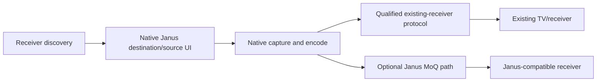

# Janus
## Product requirements, technical design, and implementation backlog

| Document | Release | Status | Research cutoff |
| --- | --- | --- | --- |
| JANUS-PRD-001 | 9 November 2026 | Implementation started; qualification pending | 9 November 2026 |

Janus is a standalone native Rust/GPUI casting application for Linux (DEB/RPM), macOS and Windows. Install Janus on the sending laptop, discover a compatible existing TV/receiver, choose a screen or application window and Cast. AzubaTV is the first physical acceptance target; support is determined by qualified protocols and device capabilities, never a name or brand check. An existing compatible receiver needs no Janus installation.

**Execution documents:** [plan.md](plan.md) defines the sequence and architecture; [todo.md](todo.md) separates implemented code from native/hardware evidence. The executable is `janus`; diagnostics are optional developer/support commands.

**Accepted product direction:** standalone Janus with direct protocol compatibility. Janus owns discovery, destination/source selection and session controls in its native UI. No Chrome, Google SDK/account/cloud requirement or OS casting-panel handoff. Supported native capture/audio/graphics APIs and mandatory privacy/portal prompts remain necessary. Keep primary UI copy minimal: choose a destination, choose a source, Cast; move technical diagnostics to Help.

**Receiver distinction:** existing TVs require their own protocol/authentication/media rules. Google Cast interoperability is the first path, with AirPlay and Miracast qualified later by OS/hardware/device capability. Janus-native MoQ and optional Janus receiving remain independent capabilities. MoQ cannot be imposed on a TV that does not understand it. Open receive mode is optional and applies only to Janus receivers; it never overrides a TV's security policy.

**Reading order** · [Assessment](#1-assessment-of-the-supplied-prd) · [Product scope](#2-product-scope-and-user-experience) · [Performance gates](#3-performance-and-reliability-contract) · [Architecture](#4-architecture-and-runtime-ownership) · [Discovery and control](#5-discovery-admission-and-control) · [MOQT](#6-janus-native-moqt-data-pipeline) · [Platform matrix](#7-platform-capture-codec-rendering-and-packaging) · [Clocks](#8-clocks-lip-sync-and-group-playback) · [Security](#9-security-and-content-protection) · [Verification](#10-verification-and-diagnostics) · [Backlog](#11-implementation-backlog-and-gates) · [Sources](#12-primary-source-register)

## 1. Assessment of the supplied PRD

**Verdict:** The draft has the right subsystem boundaries and consumer goal. It needs changes before the team can use it as a build specification. Its main risks are the delivery and trust model, assumptions about native capture and graphics, and targets that lack a measurement contract. Preserve local-first discovery, native capture, hardware codec preference, simple controls, and sender-clock timestamps.

| Draft claim or gap | Engineering finding | Disposition |
| --- | --- | --- |
| Glass-to-glass under 16 ms at 60 Hz and first frame under 150 ms | A 60 Hz refresh already takes 16.7 ms. Source sampling, receiver scanout, network variability, keyframe generation, and OS prompts add independent delay. QUIC resumption addresses only part of setup. | Measure both steady latency and time to first frame, split out human interaction, and publish percentiles by platform and network. |
| Broadcast bypasses client isolation, and six Base32 characters encode a network address and PIN | Broadcast shares the underlying reachability problem. Six Base32 characters carry 30 bits, insufficient for arbitrary IPv4 or IPv6 endpoints plus port and secret. | Use DNS-SD and an explicit direct-address recovery path. Report blocked routes clearly. |
| Fixed QUIC stream ID 0 for Janus control alongside legacy MoQ messages | MOQT draft revisions change framing and ownership of streams. The current draft reserves its own protocol behavior. | Separate Janus control and MOQT sessions. Pin an implemented revision and test it against an independent peer. |
| Stream per slice/frame with an ACK-based 12 ms reset | Separate streams can reduce transport blocking between streams. A predictive frame still depends on its references, and an ACK is neither decode nor presentation. Frequent streams add flow-control and scheduler overhead. | Start with GOP-aligned subgroups, full access units, object age limits, dependency recovery and measured subgroup experiments. |
| Larger priority byte means more urgent media | The MOQT draft assigns higher priority to smaller numbers. Quinn's stream priority interface must be mapped independently. | Define and test the priority translation against saturation. |
| Parity appended to an object recovers missing slices immediately | Parity that arrives behind the same missing reliable bytes cannot independently repair that loss. Coding has a compute, bandwidth and wait cost. | Ship Opus concealment and deadline-driven video recovery first. Gate independent FEC experiments on measured gains. |
| Guaranteed BBRv3, ECN, QoS and preset 8 MB socket buffers | Implementation support varies. Network devices can ignore markings, and large queues can make latency worse. | Qualify a stock controller and tune bounded windows with measurements. |
| Universal GPU-only and sub-85 MB 4K60 | Compositors, GPU format modifiers, driver fences and graphics adapters determine interop. Raw 4K surfaces are large even when resident on a GPU. | Prove a native fast path per GPU family and publish CPU/private memory and GPU memory separately. |
| Application timestamps deliver exact PTP and eliminate echo | RTT samples cannot identify one-way asymmetry. Speaker pipelines, Bluetooth and room acoustics add separate delays. | Fit offset and drift, schedule against the audio device, and reserve group sync for a calibrated release. |
| PIN PAKE inside TLS handshake, 0-RTT auto-start, broad “Private app” masking | TLS, pairing, and permission to start capture are distinct. Early data is replayable. OS capture exclusions have platform and ownership limits. | Use explicit open receive admission, bind each media grant to its live encrypted control connection, disable 0-RTT, and document the lack of verified device identity. |
| All features in one roadmap | Extend display, remote input, relay E2EE and multi-room introduce independent driver, trust and timing risks. | Ship a complete direct casting path first. Give each extension a separate release gate. |

This assessment records the earlier draft review; the accepted receiving policy above supersedes its former mandatory-pairing requirement. The source register in §12 ties the technical findings to primary documentation. Performance figures below are proposed targets for Janus, pending hardware validation.

## 2. Product scope and user experience

### Users and jobs

- **Presenter.** Show a single window or display on a room computer without opening network settings.
- **Home user.** Mirror a display or send system audio to another computer on the same network.
- **Receiver operator.** Make a room discoverable intentionally, enable LAN receiving intentionally, see incoming activity, and stop it locally.
- **Support engineer.** Identify permission, reachability, codec and synchronization failures from a redacted local report.

### Release boundaries

| Release | Scope |
| --- | --- |
| **Direct casting v1** | Native sender support across certified OS configurations to qualified existing receivers, one active cast per sender, display/window mirror, explicit system audio and audio-only, native in-app session controls, explicit audio scope, receiver-policy authentication, reconnect during transient drops, signed packages, and a support export. 1080p60 on qualified hardware with automatic 720p30 fallback. |
| **Quality and scale** | 4K60 SDR, additional GPU and OS qualification, optional cursor sideband, more efficient codec profiles, and optional wired group playback once synchronization is proven. |
| **Independent projects** | Relay/routed deployment, browser or TV clients, HDR/120 Hz, extend display, remote HID and managed fleets. Each gets separate security, compatibility and release decisions. |

The sending laptop runs Janus. Existing receivers need a compatible built-in protocol, not a Janus install. Google Cast, AirPlay and Miracast are distinct interoperability paths; their discovery and screen-mirroring capabilities are qualified independently. Optional Janus-to-Janus sessions use the native MoQ path. Sunshine/Moonlight is an engineering benchmark for native hardware paths and adaptive streaming. Establish comparative latency with the same scene, endpoints where possible, display mode and network. Keep claims scoped to the measured setup. “Janus” is the working name. The existing Meetecho Janus project makes package namespace, domain and naming clearance a pre-public-release task. [S12]

### Functional acceptance

| ID | Requirement | Acceptance |
| --- | --- | --- |
| R01 | Discover compatible existing receivers automatically while Cast is open. | First verify this Linux laptop discovers AzubaTV. Then qualify additional devices/brands. Handle stale entries, duplicate names, addresses and interface changes. No hard-coded receiver appears in the default UI. Optional Janus receiving advertises only while enabled. |
| R02 | Select destination/source and Cast from native Janus. | No browser or OS casting-panel handoff. Implement receiver protocol authentication and any receiver-required approval/PIN. Discovery/output flags alone never authorize media or prove live mirroring. Optional Janus receiving retains its separately documented open admission policy. |
| R03 | Share a selected screen/application window, or audio on supported paths. | Native Janus owns the source flow while respecting mandatory OS picker/permission boundaries. Audio starts off and its actual scope is explicit. Window video does not imply per-application audio. Source selection never silently widens. |
| R04 | Show a persistent sharing state and let either endpoint stop. | The sender shows the chosen source and destination with an accessible Stop action, including when the main window is closed. Receiver Escape and Stop are discoverable. A canceled picker, revoked permission, lock or deliberate stop invalidates capture and clears receiver output. |
| R05 | Adapt and recover without user tuning. | A receiver displays “Reconnecting” during a transient break, then resumes the same approved source if authorized. After timeout, lock, consent change or identity change, it requires a new cast. The UI reflects active quality and audio state. |
| R06 | Explain reachability and compatibility failures concisely. | Distinguish local-network denial, unreachable receiver, busy, authentication required, unsupported live mirroring and audio errors. Recovery stays in Janus; advanced details belong in Help. Do not fall back silently to browser, OS casting UI, media-URL playback or a relay. |
| R07 | Operate independently with privacy by default. | No Chrome/Google SDK/account/cloud prerequisite. Keep capture consent local; no recording/microphone/input in direct v1. Respect receiver security and protected content. Default reports omit identifying data and media. A receiver profile with external requirements cannot be labeled offline-qualified without evidence. |
| R08 | Offer accessible sender and receiver controls. | Keyboard-only setup, receive toggle, cast, mute and stop work at 200% scale. Focus restores after dialogs. Platform assistive technology announces discovery changes selectively, recognizes controls and conveys error and sharing state. Test Narrator, VoiceOver and Orca on certified builds. |
| R09 | Install, update and recover safely. | Native signed/trusted packages pass fresh install, offline cast, upgrade, failed-upgrade recovery and uninstall on each supported row. Previous stable protocol overlap or an actionable version mismatch is verified. |
| R10 | Meet measured latency, sync, stability and resource gates. | Pass §3 by claimed OS pairing and profile, with benchmark reports attached to the release decision. |

**Default flow.** Open Janus on the laptop. Available existing receivers appear automatically. Select a receiver and a screen or application window; enable audio explicitly if supported; click Cast. Janus shows brief status and a persistent Stop action. Any mandatory OS capture consent or receiver authentication remains part of that flow, without handing management to another casting app. AzubaTV is the first hardware target, followed by the qualified device/protocol matrix.

**UI surface.** Native GPUI owns the device list, source selection, audio and session controls. Use short labels, one primary action and contextual empty/error messages; no technical paragraphs or marketing cards in the casting flow. Put protocol, network and timing details in Help. Design fixtures require an explicit development flag. Add tray/menu-bar behavior with persistent sharing status; use the normal window when the desktop lacks reliable tray support.

## 3. Performance and reliability contract

**Reference lab.** Build a named asset inventory with CPU/GPU, driver, OS build, compositor, codec implementation, refresh mode, audio device, AP firmware, channel and configuration, packet path and Janus commit. Initial classes are a Mac mini M4, an Intel 12th-generation iGPU PC (including the GEEKOM Mini IT12 as a candidate Linux reference), a supported Windows 11 PC with hardware H.264, and an AMD iGPU Linux node for a second driver family. Physically verify each GPU and capture path. Use 60 Hz displays and wired speakers/headphones. Ethernet profile **E** is 1 GbE, RTT p95 ≤2 ms, no injected loss. Wi-Fi profile **W** is a controlled Wi-Fi 6/6E network with RTT p95 ≤12 ms under test load and ≤0.5% observed loss, receiver within ordinary room range. Run the deterministic impairment profiles separately.

| Signal | Proposed v1 gate | Measurement |
| --- | --- | --- |
| Receiver visible | p95 ≤2 s E, ≤3 s W | From opening Cast with receiver already listening to a selectable card. Separately test cold start and churn. |
| Ready cast to first picture | p95 ≤1.2 s E, ≤2.0 s W | After receive mode is enabled and source selection is complete. Separately log click-to-picture, first-time prompts and audio-only first sound. |
| Glass-to-glass, 1080p60 SDR | E p50 ≤55 ms, p95 ≤90 ms, p99 ≤125 ms. W p50 ≤80 ms, p95 ≤130 ms, p99 ≤180 ms. | Observe source and receiver light with a high-speed camera or photodiodes. Include transitions and p99, separate stale/frozen intervals from valid samples. |
| End-to-end audio, wired playback | p95 ≤100 ms E, ≤140 ms W | Physical impulse from sender audio reference to receiver analog/acoustic output. Log Bluetooth and TV DSP as separate unqualified paths. |
| Lip sync | p95 absolute skew ≤25 ms E, ≤35 ms W. Over either profile, at least 99% within ±50 ms in steady state. | Shared flash/impulse source and simultaneous output measurement. Record signed skew (audio time minus video time) and sample after startup and after output changes. |
| Media continuity and quality | Sustained moving scene ≥57 presented frames/s in ≥99% of 1 s windows on E. On W, ≥95% of 1 s windows deliver ≥95% of the active profile's nominal FPS and ≥90% of steady test time stays at 1080p60. No video freezes >250 ms E or >500 ms W in the 30-minute reference sequence. ≤1 audio gap >20 ms per W run and zero per E run. | Count unique timely presentations during motion. Report time by quality rung, concealment, freeze count and total frozen time. Static desktop periods are scored separately. |
| Recovery | After a 1 s outage, p95 first live picture ≤2.5 s from verified path restoration if receive admission and source consent remain valid. | Both peers record path recovery, new group/config, first live frame and whether source consent was preserved correctly. |
| Stop/privacy | Local sender capture invalidation ≤100 ms p95 after Stop. Receiver clears and mutes ≤250 ms p95 on a healthy path, and within 2 s on loss of authenticated control liveness. | Measure visible and audible output, buffer drain, OS capture callbacks, and fault-inject transport loss. A broken connection cannot extend receiver output by accepting buffered stale media. |
| Memory per endpoint | Idle ≤100 MiB private resident/physical footprint after warm-up. 1080p60 active p95 ≤220 MiB. Media GPU surfaces p95 ≤128 MiB where measurable, reported separately from compositor/system allocation. Active CPU fallback p95 ≤260 MiB at 720p30. | Use macOS physical footprint, Linux private resident with PSS alongside, and Windows private working set with commit alongside. Compare each OS to its own baseline. Include any helper, driver-visible allocations and total GPU/process data when available without double-counting shared buffers. |
| CPU and idle | At 1080p60 hardware path, sender and receiver each average ≤0.8 logical-core equivalent on named reference assets. Idle average ≤0.02 logical-core equivalent over 10 minutes. | Report CPU seconds/wall second, frequency/power state, GPU engine utilization, copies and thermal throttling separately. |
| Soak and cast success | ≥99% of eligible pre-authorized reference starts complete within 5 s on each claimed path, with at least 200 starts per directed OS pair across E/W. Zero crashes, live capture after teardown, or unbounded queues in a 24 h soak per OS. Idle footprint returns within +10 MiB of the post-warm baseline after 100 start/stop cycles. | Define eligibility before testing: installed, authorized, reachable, supported hardware, endpoint awake and no deliberate user cancellations. Publish denominators and confidence intervals. Treat crashes and failed starts as failures. |

The 1080p60 targets allow approximately 0–17 ms for source cadence, 4–12 ms for capture/convert/encode, 1–8 ms Ethernet for network and scheduling, 8–25 ms for bounded receive/decode scheduling, and 0–17 ms for display cadence, plus device-specific scanout and headroom. These are profiling allocations. End-to-end percentiles come from physical measurements. Timestamp spans can diagnose the budget but cannot replace physical measurements. A ≤35 ms p95 hardware fast path is a research target only. For 4K60, define separate CPU/GPU, thermal and image-quality gates once the reference prototype is measured.

For each mandatory directed pair, sample at least 1,000 visible transitions across three runs per E/W profile and a separate 30-minute continuity run per profile. Exercise static text, scrolling, full-screen video, transitions and protected-content cases. Score text with a reference small-font chart and include a decoded crop alongside image metrics. Archive driver/build and calibrated fixture error. Include failed display transitions as misses in continuity, even when a latency value cannot be recorded. A convenience-device test or anecdotal comparison does not establish a product claim.

## 4. Architecture and runtime ownership

| Boundary | Ownership and invariant |
| --- | --- |
| GPUI desktop shell | User intent, accessibility, settings, active indicator and projected session state. No media buffers or I/O waits in view entities. |
| Session coordinator | Single owner of the state machine, permission leases, role, generation and cancellation tree. UI sees an immutable snapshot and sends bounded commands. |
| Discovery and admission | Candidates have no identity authority. Explicit open receive mode permits LAN requests; a live control connection owns each grant. Future remote enrollment is a separate policy. |
| Native adapters | Own OS API objects on the required thread/apartment. Capture and decoder surfaces cross threads only through explicit ownership or a supported handle import. |
| Media scheduler | Controls capture admission, compression profile, tracks, buffers, deadlines, and receiver playout. Jobs are associated with a generation and canceled on teardown. |
| Transport adapter | Handles MOQT and QUIC versioning, peer identity hooks and flow control. Exposes queue ages, stats and a deadline-oriented media interface to the scheduler. |
| Audio callback | Reads or writes a preallocated single-producer/single-consumer ring, fills output with silence on starvation and updates counters. Allocation, locks, resampling and logs run elsewhere. |

Start with a single desktop process and separate GPUI, network, native media and audio execution contexts. Use a dedicated control/coordinator task in Tokio with a bounded command queue. Run OS callbacks and codec API threads according to their platform contracts. Prefer a single publish/decode task per active track and use structured cancellation and join deadlines. Process isolation for media decode remains a security review decision at the first gate, with hardware resource-sharing and failure recovery measured if introduced.

**Rust workspace.** Use Edition 2024 and pin Rust toolchain, GPUI revision, QUIC and media dependencies. Initial crates are `janus-app`, `janus-session`, `janus-discovery`, `janus-wire`, `janus-moq`, `janus-media` and `janus-platform`. Keep platform modules behind target features and define only small native traits that real backends need. Keep the `janus` executable in `janus-cli`; explicit synthetic checks live under `janus diagnostics`, separate from normal casting controls. `janus-session` owns security policy and composes transport/discovery/media through typed interfaces. `janus-wire` has no GPUI or hardware dependencies. Expose distinct sender and receiver role permissions despite the shared binary. Confine `unsafe` to reviewed FFI and buffer-lifetime boundaries. Document ownership, callback lifetime, thread rules and release fence for each unsafe path.

## 5. Discovery, admission and control

### Discovery and network support

Browse existing Google Cast services (`_googlecast._tcp.local.`) and optional Janus services independently. Share one bounded DNS cache and live latest-value snapshot model, with protocol-specific metadata decoding separated from caching. Handle split PTR/SRV/TXT/address replies. Distinguish advertised audio/video output from actual mirroring support, and keep unverified receivers from being presented as proven ready to Cast. The first physical acceptance test is this laptop → AzubaTV; synthetic fixtures do not close it.

Additional AirPlay/Miracast paths must qualify their own discovery, authentication, source types and streaming capabilities across the sender OS matrix. No receiver capability is inferred from its friendly name. Direct native protocol interoperability does not require Google SDKs, Chrome, cloud accounts or OS casting UI.

For **optional Janus-native receiving only**, advertise `_janus-cast._udp.local.` only when Receive casts is enabled. PTR/SRV/A/AAAA supply candidate endpoints; TXT contains protocol major and coarse readiness only. No keys, stable identifiers or hardware details in DNS-SD. Treat names and routes as untrusted input. Sanitize display labels and bound packets, records, TTLs and candidates to 128. Handle goodbye, cache flush, duplicate names, interfaces, sleep/wake and IPv6 zone indices. Receive-off withdraws advertisement and denies admission even if another machine retains a cached card.

Browse authorized local interfaces. Prefer the last healthy address family, otherwise stagger two candidate dials by 200 ms and cancel the loser. Resolve name collisions with the DNS-SD provider before advertising. An explicit direct address under Help handles filtered multicast; it does not bypass firewalls or AP isolation. Never add UPnP mappings. Native/signed-build tests must cover macOS Local Network permission, Windows private firewall rules, Linux zones and portal sandbox behavior. IPv4-only default-interface discovery in the current implementation is a partial implementation, not certification of this contract.

### Optional Janus-native open receiving and connection authorization

1. Receive mode starts off. Turning it on is the receiver's authorization for reachable LAN clients to start one received cast. There is no device pairing, code entry, remembered-trust requirement or receiver approval dialog. Explain this network access beside the toggle. A same-network label is not verified identity, and private addresses alone cannot prove the same broadcast domain.
2. QUIC TLS 1.3 encrypts control and media. In open mode, bounded self-signed endpoint certificates prove key possession through TLS handshake signatures without a trusted device directory. No PKI/device ownership or active-MITM resistance is claimed. Disable 0-RTT. Never use the open verifier for future internet enrollment, update verification or remote input authorization.
3. A control connection owns its session ID, generation and request sequence. Issue a fresh media grant only while receiving is enabled and idle. Bind the grant to the control exporter, both connection keys, receiver instance, exact media namespace and allowed tracks. Verify it before accepting or forwarding payloads. One active session and one media connection per grant. Neither a DNS label nor a guessed session ID authorizes media.
4. Reject competing senders while busy. Receiver Stop disables receiving and revokes the grant; sender Stop ends its own session. Local source consent is mandatory and cannot be granted remotely. Permission revoke, lock, suspend, source closure and receiver-off blank/mute and cancel the session. Idempotent retries cannot extend leases or resurrect stopped sessions.
5. A lease expires after two seconds without authenticated control liveness. Blank/mute immediately at expiry. Recovery on the same live control identity requires a new generation and fresh decoder group; full reconnect needs a new grant and re-evaluation of source consent. Old frames never resume. Blocked routes produce actionable errors rather than relay fallback.
6. Hybrid key establishment remains a qualification target. Current ring-backed control diagnostics do not establish the PRD's proposed hybrid requirement. A production release must record the actual provider/group and policy; no silent cryptographic downgrade claims. Relay enrollment and E2EE receive an independent design and review gate.

### Janus-native control wire and lifecycle

The following QUIC/Protobuf contract belongs only to Janus-compatible receivers. Existing TVs use their own verified control/authentication/session wire protocols; never send this contract to AzubaTV merely because it was discovered.

The sender is QUIC client for both connections and MOQT original publisher. The receiver is the QUIC server and MOQT subscriber. Separate control and media with distinct ALPNs, shared listener only if the selected QUIC/adapter combination can enforce the separation. Otherwise use one control listener discovered by DNS-SD and one media endpoint advertised over authenticated control. Use `janus-ctrl/1` for control and the selected MOQT revision's ALPN for media. Keep this distinction even if port sharing is possible. A second QUIC congestion controller adds little traffic for control, but control liveness under media saturation still requires a lab gate. Do not add Janus frames to MOQT control streams. [S2, S3]

Use one application-opened bidirectional control stream, framed as `u32 big-endian length | Protobuf Envelope`. Bounds are 16 KiB per message, capped repeated fields, bounded nesting, 64-character sanitized labels, and at most eight concurrent outstanding requests. Suggested envelope numbers: 1 = request ID, 2 = 128-bit session ID (absent in initial Hello), 3 = generation, 4 = sender sequence, 5 = reply-to request ID, 6 = schema minor, 10 onward = typed payload `oneof`. Reserve retired tags. Reject invalid lengths before allocation. Dispatch only valid role/state combinations. Reject a missing or unsupported command with a bounded typed error. Unknown optional fields may be ignored within a negotiated major; different major rejects safely. Use generated code and published golden vectors. Clock and freshness-sensitive feedback may use small QUIC datagrams on the authenticated control connection, with stream fallback for clock probes when datagrams cannot be negotiated. Validate replay windows and age for datagram control.

| Message family | Contract |
| --- | --- |
| Hello / HelloAck | Version ranges, role, random nonce, bounded feature IDs. Establish capabilities only after authentication. |
| Admission / Grant | Receive-enabled coordinator verifies connection ownership and idle capacity; media remains blocked until a fresh exact grant is registered. |
| Offer / Accept / Reject | Source type only, requested audio scope, supported codec profiles and receiver playout limits. Accept returns media endpoint, namespace and grant generation. No source titles in wire metadata by default. |
| Ready / Started | Receiver validates codec config and clock startup, opens the playout path, and reports first presentation. No preview frames before sender consent and a live media grant. |
| Feedback / KeyframeRequest / ConfigChange | Report delivered rate, queue age, playout and dependency gaps, coalesced at 5–10 Hz. Config changes carry an effective generation/group and codec config version. Duplicate keyframe requests are rate-limited. |
| Heartbeat / Resume / Stop / Error | Renew authenticated liveness, confirm live receive admission and sender source consent on resume, and make Stop idempotent. Mutating requests carry correlation and an exact generation. Reject stale generations and deduplicate retried commands in a bounded per-session cache. |

State transitions are **Idle → Dialing → Authenticating → Negotiating → Starting → Casting → Recovering → Casting or Closing → Idle**. An explicit Stop, receive-off, revoked OS capture, lock or suspend transitions directly to Closing and takes precedence over reconnect. Drive each generation with a cancellation token and reject all callbacks from prior generations. Use monotonic deadlines. Start defaults are 3 s dial, 5 s negotiation/start after source selection, and up to 10 s to recover the active session with exponential backoff and jitter. Liveness heartbeats every 500 ms with a 2 s output lease; on loss blank/mute, release capture after the recovery limit, and re-evaluate source consent on both peers. Quiesce sender capture and purge receiver media on explicit Stop. Within recovery, drop capture frames rather than queueing them. Same authenticated connection migration may keep identity, but validate path, re-check scope and re-probe timing. On full reconnect start a new generation and request a fresh IDR. Never replay old frames. On shutdown, blank/mute and release user capture before any best-effort network acknowledgement.

## 6. Janus-native MOQT data pipeline

### Version and implementation decision

This section qualifies the independent Janus-native transport. The existing-TV compatibility path must implement the destination protocol rather than assume MoQ support.

The original research references **MOQT draft-23**, **LOC draft-05**, and **MSF draft-01**; these reference revisions are not a claim of implementation support. Earlier research described Cloudflare draft-18 and moq-lite. The locally inspected moq-net 0.2.21 declares IETF drafts 14–21 alongside moq-lite; defaults prefer moq-lite, so Janus qualification must explicitly pin an IETF version. Cloudflare and draft-23 claims have not been revalidated in the offline environment. See docs/moq-qualification.md for exact evidence. Reference revision and implementation maturity must be tracked separately. Use draft-23 as the design reference and prefer a qualified IETF implementation. At Gate A select and pin a supported revision, exact dependency commits, features, ALPN, license and matching peer vectors. A supported older draft can unblock an internal vertical slice with explicit incompatibility recorded. Public protocol claims must name the qualified revision and tested features, and ship with a version upgrade path. Try the two libraries against the acceptance harness before writing a new transport. A raw Quinn prototype can isolate performance bugs but cannot satisfy the MOQT release gate by itself. [S3]

| Transport option | Fit for Janus | Decision |
| --- | --- | --- |
| Native QUIC + MOQT | Deadline-aware stream policy and independently useful media objects, with a standards-track route to relays. Draft churn and library hooks are the main costs. | Primary media path. |
| WebRTC/RTP | Mature realtime recovery, congestion control and NAT traversal. Useful as a measured baseline and for a future browser/WAN path. | Benchmark a comparable native pipeline if the MOQT target misses. Any fallback requires a separate product and security decision. |
| Raw QUIC application framing | Fast way to isolate transport, codec and buffer performance in a lab. Owning long-term protocol interoperability would add a separate maintenance burden. | Lab reference only. |

Use LOC when the chosen revision/implementation pairing passes payload vectors. Use an authenticated Janus media offer for track discovery in v1. MSF catalog interop is a separate qualification. If an older profile needs a Janus-defined object payload envelope, keep its syntax version separate from MOQT and document the precise interoperability limits. Keep vendor containers and codecs outside the transport layer.

### Media profile and buffers

| Track | Initial delivery and format | Scheduler behavior |
| --- | --- | --- |
| Video | H.264 8-bit 4:2:0 SDR. One coded access unit per object. GOP starts with IDR; subgroup default is one per GOP. START config carries validated profile, level, resolution, color metadata and parameter sets. Normalize backend framing at adapter boundary and publish one canonical wire format per negotiated profile. | Disable frame reordering and lookahead when supported. Start with a 500 ms GOP on Ethernet, adaptive up to 1 s, with on-demand IDR rate-limited to one per 250 ms. Drop a stale dependency chain and begin at a clean random-access group. Try finer subgrouping only when dependent-frame recovery and memory data justify it. |
| Audio | 48 kHz, stereo Opus, 10 ms packets, initial 96–160 kbit/s. One packet per MOQT Object Datagram where negotiated. Group by bounded time window, maintain monotonically increasing IDs within each group. | Require complete object + metadata to fit negotiated datagram payload and actual path limit. Select a separate stream-delivery profile with short bounded subgroups when datagrams cannot carry the chosen packet. Use PLC for missing packets, and enable Opus in-band FEC only when packet duration, encoder mode and wait budget support it. |
| Cursor | v1 uses the OS capture cursor where the permission/backend exposes it. | An optional later track can transmit scoped coordinates and shape changes. Use latest-wins semantics for position and reliable, bounded shape updates. |

**Join sequence.** After receive-enabled admission and the sender confirms its native source, authenticated control returns the granted track names and media endpoint. The sender dials the receiver with the media ALPN and mutual TLS. Prefer receiver-initiated subscriptions to exact authorized track names after MOQT setup. If the chosen implementation requires a publisher-initiated flow, verify the grant before accepting the request and wait for acceptance before forwarding media. On each subscription, generate a fresh video random-access group and start from the live edge. The receiver primes a bounded audio buffer, validates decoder configuration, and reports first presentation. Keep archive/fetch disabled in v1. Audio delivery mode remains fixed for each object. Switch tracks at a negotiated generation boundary if MTU or capability changes persist. Datagram paths share QUIC congestion control and may be dropped. Do not split a large video access unit into an implicit IP-fragmented datagram. For a later independent parity path, define a separate application profile with explicit shard IDs, limits, retransmission and integrity policy. Keep FEC from competing with audio and fresh keyframes. [S2, S3, S7]

**Timestamp contract.** Each access unit has a capture timestamp in the sender session monotonic domain and a sample duration. The track metadata fixes timescale, codec configuration and clock generation. Map timestamps into LOC's defined fields when using LOC, and define any extra presentation metadata in the profile. For the experimental Janus envelope, specify byte order, version, flags, config generation, 64-bit relative capture time, duration, payload length and bounded bytes. Do not treat capture time as a receiver deadline. The receiver converts capture time and schedules using the current clock model and target delay. Freeze the mapping for already committed audio samples. Cap discontinuities and future times and flush stale objects on generation change.

**Priorities and deadlines.** Send control feedback and audio ahead of expendable video. MOQT priority semantics and Quinn scheduler semantics must be translated and saturation-tested. Start with a qualified stock QUIC controller (CUBIC with Quinn if selected), default ECN and no mandatory DSCP. Receiver reports useful media throughput, playout lateness, jitter and dependency gaps. Sender tracks measured RTT, loss, stream occupancy, encoder time and newest raw frame age. Admission uses capture age and predicted remaining network/decode time. The receiver drops expired video before decode/present and bounds audio concealment. Reset an expired video subgroup if supported by the selected draft and implementation. A reset discards its remaining objects, so request/restart on a clean group if the dependency chain is broken. Use an independently enforced hard timeout rather than waiting for remote ACKs.

**Adaptation.** Sample over 200 ms windows. Start with a qualified lane such as 1080p60 at 8 Mb/s nominal, 720p60 at 5 Mb/s, 720p30 at 2.5 Mb/s, and 540p30 at 1.4 Mb/s. Set headroom below measured useful throughput and cap keyframe bursts. On sustained queue growth, late frames or available-rate decline over two consecutive windows, reduce bitrate first, then lower frame rate/resolution if pressure persists. If audio/control is at risk, bypass hysteresis to protect both. Require 5 s healthy headroom before raising one rung, and hold changes for at least 2 s unless an emergency downshift is required. Reconfigure on a clean IDR; increment codec config generation and ask the receiver to discard old decoder work. For text-heavy content prioritize keeping resolution while trimming frame rate. When the pipe cannot sustain the minimum lane, show a recoverable connection problem instead of building backlog. Allow the user to choose audio-only explicitly. Log reasons and active rung.

**Initial caps to validate.** Limit raw staging to two frames outside the platform-owned pool, use a replaceable newest capture slot, and account for every additional surface held by capture, encode, decode and present. Start with three encoder and four decoder/present surfaces as tuning budgets where backends permit. Budget 4 MiB encoded application video queues per endpoint, one access unit ≤2 MiB for the baseline profile, ≤6 open media subgroups in each direction per media session, and ≤8 MiB combined transport receive/send application-visible buffer budget per media connection. Verify actual QUIC windows and socket memory separately. Hold a default 20–60 ms receiver audio target (max 120 ms queued media; locally allocated ring can have a larger preallocated capacity), and cap video decode/present staging to two frames or 40 ms, whichever expires first. Apply per-peer and global limits before allocation. Request an IDR and drop/step down if a bounded video access unit cannot be admitted. Coalesce diagnostics and use capped buffer pools only where profiling shows allocation cost.

At 1080p an unpadded NV12 surface is about 3 MiB and BGRA about 7.9 MiB. At 4K they are about 11.9 and 31.6 MiB respectively. A four-surface 4K BGRA pool already consumes about 127 MiB before alignment, codec surfaces, graphics swapchain and transport. Hardware residency can reduce CPU traffic while GPU allocations still need explicit limits. Measure both fast-path and fallback residency, allocation churn and transfer bytes.

## 7. Platform capture, codec, rendering and packaging

Sender capture/codec/audio adapters feed the selected receiver protocol. Janus-native receiving/rendering below is optional; it is not a prerequisite for casting to existing devices. The product owns all user-facing management in GPUI. OS APIs and required privacy prompts do not authorize OS casting-panel/browser handoff.

| Certified v1 candidate | Capture and permission | Audio capture and output | Codec and presentation |
| --- | --- | --- | --- |
| **macOS 15+ on Apple Silicon**. Test supported, patched macOS versions and the minimum version explicitly. | ScreenCaptureKit and system content picker, TCC screen/audio permissions and Local Network privacy. Gate APIs by availability and test signed release identity. | ScreenCaptureKit for supported screen capture audio. Use a Core Audio tap for standalone audio-only where the required API and permission are validated. Core Audio for playback and device timestamps. | VideoToolbox H.264 with realtime settings and supported low-latency encoder specification. Inspect actual hardware use and color format. CVPixelBuffer/IOSurface → Metal texture cache → native presenter. |
| **Windows 11 x64, supported builds**. Certify at least one supported baseline and the current supported build used in the lab. | Windows Graphics Capture picker for display/window; test permission, border behavior, minimization and device removal. Evaluate DXGI Desktop Duplication separately for supported display-only cases. | WASAPI shared-mode loopback for explicit system audio, and WASAPI render with device-clock reporting. Process-specific loopback is an optional qualified capability. | D3D11 textures, Media Foundation hardware MFTs and DXGI device manager. Prefer same adapter. Use explicit synchronization and a native D3D presenter. If backend interop fails, bound transfer cost and report fallback. |
| **Fedora Workstation 44/45 and Debian 13 x86_64, GNOME/Wayland**. Release policy follows supported OS builds. KDE/Wayland gets its own qualification. | XDG ScreenCast portal + PipeWire remote. Portal-controlled source picker. Respect advertised source and cursor types. Import DMA-BUF only with supported format, modifiers, fences and hardware. Provide a bounded SHM path. | Explicit sink-monitor selection through PipeWire where desktop/session policy permits. XDG ScreenCast provides video, so audio is a separate capability. Use PipeWire render timing. Avoid presenting global audio as window-only. | Start with VA-API on qualified Intel/AMD combinations. Import DMA-BUF with explicit plane layout and ownership. Native Linux GPU presenter with a bounded copy fallback. NVIDIA and X11 are additional qualification rows. |

Source/format changes, monitor disconnects, screen lock, fast user switching, sleep, color-space change and audio-device changes all require explicit adapter events. A selected source closing ends the cast. Require fresh consent on a source replacement. If the audio route disappears, mute it, explain the state and re-qualify output timing before resume. Validate pixel stride, visible size, crop, rotation, YUV range/matrix and dimensions before upload. v1 converts or caps input to SDR and tells the user when source support requires it. Use the OS-reported cursor mode. Window hiding/minimization and portal suspension blank or end according to tested OS semantics, without switching silently to full desktop.

Prefer a separate native video presenter integrated with GPUI window lifecycle and controls. Prototype composition, fullscreen, HiDPI, resizing and z-order early. An independently rendered receiver window with accessible GPUI controls is acceptable if texture injection is fragile. Use a custom GPUI texture element only when the pinned platform renderer exposes suitable import/lifetime hooks and it passes the same device-loss tests. Track zero-copy per stage and label verified zero CPU readback, GPU copy, or CPU copy. The declared software lane is capped at 720p30 pending codec distribution review and thermal testing. If a legal/qualified encoder or decoder is unavailable, expose audio-only capability or a clear “Video unavailable” state. A supported v1 row must pass its declared video lane on certified hardware.

**Package and update.** macOS ships a Developer ID-signed and notarized DMG with correct bundle identity and usage strings. Windows ships a signed MSIX or MSI selected after installer and private-firewall tests, with WinGet as a distribution channel after signing. Linux ships a trusted/signed APT repository with DEB, and a signed RPM/repository. Validate Flatpak separately for portal permissions, local discovery, PipeWire audio and driver availability. Publish checksums, provenance, SBOM, third-party notices and required runtime dependencies. Select H.264 providers and distribution terms before public builds, including any software fallback. Check minimum OS/driver requirements against signed install artifacts rather than developer builds. Own a signed update and rollback path, compatibility for previous stable settings and protocol records, and a documented process for revoking a signing key. [S4, S5, S10, S11]

## 8. Clocks, lip sync and group playback

Custom clock probes, receiver resampling and playout control below apply to Janus-native receivers. Existing TVs require protocol-specific timing and measured receiver-buffering profiles. Report actual physical performance per protocol/firmware; do not transfer MoQ-profile targets to them without validation.

The clock problem has three parts. First map sender time into the receiver monotonic domain. Then map the receiver's output device sample counter to physical playback time. Finally choose video presentation against the same timeline. Measure all three. Janus application probes use NTP-style math and cannot determine exact one-way delays over asymmetric links.

| Timestamp | Domain |
| --- | --- |
| t1 | Receiver probe send |
| t2, t3 | Sender probe receive and reply send |
| t4 | Receiver reply receive |

Compute RTT = (t4 − t1) − (t3 − t2), and sender-minus-receiver offset = ((t2 − t1) + (t3 − t4)) / 2. Begin with a short burst of 6–10 authenticated probes spaced 20–40 ms, then sample at 2 Hz during a healthy session. Fit an affine model `sender_time = a × receiver_time + b` with monotonic origins removed, using low-delay samples from a 30–60 s rolling window. Until enough span exists to fit drift, use unity slope and label uncertainty. Filter reordering, negative or implausible RTT, stale replies, CPU stalls and outliers. Track confidence via delay spread and residuals. On path/device changes reset the affected estimator, enter bounded holdover, and increase buffering or re-prime if confidence degrades. Use the inverse affine mapping for scheduling, then add the current playout target. [S8]

**Audio playout.** Convert actual native capture timestamps and sample counts into the common sender timeline. Account for codec lookahead, ring occupancy, render device padding and measured output latency. Schedule a decoded packet based on capture time plus the target delay in the receiver domain, and anchor the local playhead to the OS-reported device position/time. Use a slow bounded PI-driven ASRC off the real-time callback to stabilize ring fill against the audio hardware clock. Start with ±250 ppm correction, slew/rate caps and anti-windup. Control target delay separately from rate correction. When the discrepancy exceeds the recovery limit, crossfade or mute/re-prime instead of driving the controller harder. Validate ±100 ppm and ±200 ppm drift, 30-minute drift tests, discontinuities and clock-wrap/arithmetic cases.

**Video playout.** Schedule from the same source timeline. When audio is active, correct video against the measured audio playhead rather than GPUI tick time. Target the first appropriate presentation/vsync, use available present-completion feedback and drop stale pictures. In video-only mode the receiver monotonic clock anchors presentation. Device changes can temporarily invalidate lip-sync guarantees, so report re-sync and measure time to converge.

**Echo and later grouping.** Two independently audible outputs can produce an echo even when each receiver's audio and video are synchronized. With one receiver, offer a clear “Play sound on receiver” choice and local mute guidance. Never mute the system output in a way that also silences loopback capture, and restore any temporary routing on exit. Avoid recapturing Janus playback where the OS supports exclusion. For group mode, use a future common sender-clock start time, receiver lead-time/uncertainty reports, per-device delay calibration, and a group delay set for the slowest accepted member. Start with two wired receivers on calibrated output, p95 electrical output skew ≤2 ms as a prototype target. Bluetooth and room propagation remain separate; sound traveling one meter adds roughly 3 ms. Offer calibrated co-located playback only after physical tests, and treat microphone echo cancellation as a separate future feature.

## 9. Security and content protection

Existing receiver compatibility must authenticate/control devices according to that protocol. The Janus open-receive TLS verifier is never a replacement for another protocol’s device authentication. Source permissions and DRM restrictions remain enforced. The open-LAN receiving rows below apply only to optional Janus receivers.

| Threat | Control and verification |
| --- | --- |
| Unwanted LAN sender | Receiving starts off; enabling it accepts reachable LAN senders without pairing. Persistent indicator, busy rejection and receiver Stop/receive-off. Explain this admission model. It cannot authenticate ownership from discovery. |
| Active LAN impersonation | Open TLS proves connection-key possession, not trusted device identity. Do not claim MITM protection. Remote/routed enrollment must use a reviewed verified identity and E2EE policy rather than this open verifier. |
| Replay or leaked grant | 0-RTT off; connection ownership, session/generation/sequence, bounded request deduplication, exact grant and lease. Stop/revoke/lock/expiry purge media. |
| Flooding and parser abuse | Bound unauthenticated handshakes/connections, request rate, streams, message/object sizes and preallocation. Validate dimensions/configuration before surfaces. Fuzz DNS, Protobuf, MoQ/LOC and codec configuration. |
| Capture privacy | Native source picker and OS scope, explicit system audio, no microphone/input/recording in v1. Source closure never falls back silently to whole desktop. Protected content restrictions remain enforced. |
| Malicious admitted endpoint | Treat decoder input as hostile. Review decoder isolation and unsafe FFI before distribution. An admitted receiver can copy presented content; transport encryption is not DRM. |
| Diagnostics | Default local report omits names, source titles, paths, addresses, tokens, fingerprints and media. Detailed reports are opt-in, bounded and local. |
| Distribution | Exact dependency revisions/lockfiles, license checks, signed packages and updates, provenance, SBOM, protected signing credentials and tested rollback. |

Use supported ScreenCaptureKit filters, Windows capture APIs and Wayland portal scope. Global “private apps” masking has no universal guarantee. Blank receiver output on lease expiry. Future relay TLS is hop-by-hop; add reviewed sender-controlled content keys, unique nonces, authenticated metadata, replay windows and member rekey/revoke before external relay release. Remote input always needs separate explicit permission.

## 10. Verification and diagnostics

- **CI split.** Run formatting, Clippy, unit/property tests, schema/vector compatibility, dependency policy, fuzz smoke and headless fault tests on each supported toolchain. Use native hardware runners for capture, GPU, audio and signed package tests. Linux virtual machines are useful for install and protocol tests. Physical capture-to-display performance needs real endpoints and audio/display instruments. Use nightly network emulation and scheduled 24 h soak runs.
- **Platform coverage.** First test this Linux sender against AzubaTV without receiver installation. Then test each claimed sender OS against qualified receiver devices/protocols/firmwares. Add every ordered desktop pair as an optional Janus-native matrix. Run IPv4-only, IPv6-only, dual stack and scoped IPv6 discovery for the release matrix, and explicitly test firewall prompts and local network denial on installed signed builds. Test at least one cross-platform direction for each injected network fault and repeat every release-critical fault across adapter families.
- **Fault profiles.** Exercise blocked multicast with routable UDP, AP isolation, unexpected VPN adapters, IPv6 link-local scope, MTU changes and datagram disabled, 0.5%/2%/5% loss, 5–50 ms jitter, burst loss, 1 s path interruption, and bandwidth steps (25 → 5 → 2 → 15 Mb/s). Verify graceful downshift and bounded queues under severe conditions. Include competing TCP/QUIC traffic and CPU/GPU contention. Expect the UI to explain a sustained path below the minimum lane. Record the applied traffic rules and actual path.
- **State and abuse.** Test duplicate, late, truncated and out-of-order inputs, two competing senders, network churn during admission, interrupted settings writes, clock drift, packet replay, invalid time/length fields, decoder failure, permission revoke, lock, sleep/wake, app crash and abrupt receiver disconnect. A device can only hold one admitted active session at a time. Verify no stale frame or command crosses generation boundaries.
- **Privacy and UX.** Test offline onboarding on a clean user profile. Run a formative test with at least 12 non-engineers across platform families. Target at least 10 independent completions of first receive setup and cast within 60 s after app launch and success for all participants at locating Stop within 5 s of being asked. Capture task failures and reasons. Validate assistive technology and receive-toggle explanations separately. Verify receive-off enforcement and exported redactions.
- **Release evidence.** Export a local bounded report with version, platform capability tags, state transition and typed failure categories, negotiated protocol/codec/crypto, queue age and bytes, RTT/loss, clock confidence, A/V skew estimate, encode/decode and playout stats. Distinguish measured end-to-end latency from internal estimates. Log transitions and summarized counters rather than per-frame logs. Use low-cardinality metric labels. Include test denominators, asset/config identifiers and regressions against previous builds.

## 11. Implementation backlog and gates

**Current priority:** COMPAT discovery → native existing-receiver control/authentication → real laptop-to-AzubaTV live mirroring → additional receiver and sender OS qualification. See todo.md for the revised tasks; legacy A–E IDs below retain useful subsystem work and do not mandate Janus installation at the destination.

**Dependencies are ticket IDs.** Roles are ownership areas and can be assigned to the same person in a small team. A ticket closes with its implementation and evidence. Native backend work can run in parallel after stable adapter and timestamp contracts. The media, UX and security gates all block the first public release.

| ID | Owner | Depends on | Implementation and evidence |
| --- | --- | --- | --- |
| A01 | Product / QA | — | Confirm supported rows, modes, non-goals and baseline hardware. Record OS lifecycle, package channel and codec providers per row. Approve R01–R10 and which numeric targets are release blockers. |
| A02 | Build | — | Create Rust workspace, toolchain/GPUI pins, linting, native CI jobs, lab fixture structure and signed-build prerequisites. Smoke-launch on all four OS rows. |
| A03 | Transport | A02 | Compare Cloudflare MOQT and moq-dev on raw QUIC support, revision, interop, auth hooks, deadline control, datagram support, licenses and maintained cross-builds. Select a pin and prove independent-peer publish/receive and malformed-wire rejection. |
| A04 | Platform | A02 | Spike GPUI accessibility/renderer and native capture → hardware encode/decode → native present on Linux, macOS and Windows. Record copy path, permission behavior, driver, memory and surface ownership. |
| A05 | QA / Media | A02 | Build deterministic test pattern, flash/impulse fixture, clock-drift driver, queue/memory counters, packet shaper and capture/display event correlation. Calibrate and retain a baseline recording. |
| A06 | Security / Release | A01, A03 | Review threat model, open receive policy, TLS/grant APIs, unsafe/decoder isolation, dependency/codec redistribution, product namespace and package signing. Record accepted design decisions and blocking findings. |
| B01 | Protocol | A03, A06 | Specify and implement control envelopes, typed errors, handshake/offer/stop messages, parser limits, golden vectors and fuzz entry points. Test old/new compatible minor behavior. |
| B02 | Discovery | A02, B01 | Build IPv4/IPv6 DNS-SD, interface churn, stale entries, signed app permission tests and direct-address routing. Demonstrate blocked-multicast success and AP-isolation failure messaging. |
| B03 | Security | A06, B01 | Implement explicit open receiving, TLS key possession, connection-bound grant admission, busy rejection, receive-off and rate limits. Test cross-connection grant theft, replay and stale generation. |
| B04 | Session | B01, B03 | Implement state machine, liveness, generation checks, mTLS/grant binding, Stop and recovery. Assert that expired/revoked sessions neither decode nor re-open capture. |
| B05 | Desktop | B01, B02 | Implement tray/launcher, discovery cards, receive toggle, receive admission, source consent, errors, persistent indicator and keyboard Stop. Run early screen-reader checks on pinned GPUI. |
| B06 | Product | — | Removed from direct v1: optional PAKE/PIN conflicts with the agreed no-pairing flow. Retain ID for history; no implementation required. |
| C01 | Transport | A03, B04 | Build media adapter and chosen LOC/profile. Verify IDR groups, live-edge attach, codec configs, object/stream bounds, authorization and zero history. Produce packet vectors. |
| C02 | Media | A04, C01 | Build capture/codec/presenter interfaces, raw and encoded queue caps, buffer/fence ownership, decoder reset and stale dependency discard. Deliver headless synthetic source → real decoder → display. |
| C03 | Linux | A04, C02 | Implement GNOME Wayland portal/PipeWire, DMA-BUF and SHM, VA-API, native output and explicit sink-monitor audio. Certify Intel/AMD paths and Fedora/Debian rows independently. |
| C04 | macOS | A04, C02 | Implement native picker, ScreenCaptureKit, VideoToolbox, Metal presentation and Core Audio. Validate audio-only and permission workflows with notarized test build. |
| C05 | Windows | A04, C02 | Implement WGC, D3D11/MFT, WASAPI capture/render, output timing, multi-GPU fallback and device-loss cleanup. Validate private firewall/packaged workflow. |
| C06 | Audio / Timing | A05, C01 | Implement Opus, datagram fit check, stream fallback, PLC, ring and device playback interfaces. Demonstrate bounded playout with packet loss and MTU variation. |
| C07 | Timing | A05, C06 | Implement probes, affine mapping, ASRC, audio master and video scheduling. Pass synthetic drift/asymmetry and physical skew tests on each native audio path. |
| C08 | Transport / Media | C01, C02, C06 | Implement bitrate ladder, rate/deadline feedback, IDR recovery and config switching. Verify audio/control under saturation and measure stability under bandwidth steps. |
| C09 | Desktop | B04, B05, C02, C07 | Wire OS permissions, source selection, receiving window/fullscreen, mute/volume, profile/connection indicators and support export. Validate stop and failure screens with assistive technology. |
| D01 | QA / Performance | C03, C04, C05, C07, C08, C09 | Run directed hardware matrix and benchmark §3. Record p50/p95/p99, quality rung, private/GPU/kernel memory, CPU and failure denominators. Remove unsupported capability claims. |
| D02 | QA / Security | B04, C08, C09 | Run abuse/fuzz, privacy cases, soak, leak checks and fault matrix. Attach mitigation and independent review findings for parsing, pairing and decoder exposure. |
| D03 | Release | A06, C09 | Produce signed packages, update/rollback verification, SBOM, provenance, licenses, support notes and install matrix. Prove previous stable interoperability or clear mismatch. |
| D04 | Product / QA | D01, D02, D03 | Run pilot onboarding, triage and publish the certified device/OS rows, measured profiles, unresolved limitations and release decision. |
| E01 | Media | D04 | Qualify 4K60 SDR and test optional HEVC/AV1 only with verified hardware paths and distribution terms. Retest text quality, thermal load and resources. |
| E02 | Timing | D04 | Prototype group clock and calibration on two wired receivers. Capture physical skew, join/leave, recovery and sender bandwidth impact. |
| E03 | Transport / Security | D04 | Study relay/routed discovery, aggregate bandwidth and sender→relay→receiver trust. Test interoperable secure objects and member revocation before any external deployment. |
| E04 | Transport / QA | D04 | A/B test alternative subgroup strategies, Opus FEC and independent video parity. Keep experiments only if late drops or freeze time improve at the same latency, useful quality and resource budget. |

| Gate | Entry evidence | Exit decision |
| --- | --- | --- |
| **A — Architecture** | A01–A06 | Select a pinned MOQT stack with peer authentication hooks, working media path, version strategy and checked license. Confirm viable native capture/render and accessibility path. Record provisional performance values and explain any unsupported rows. |
| **B — Private vertical slice** | B01–B05, C01, C02, one native sender/receiver path | Enable receiving, authorize locally, stream video, stop and reconnect without stale media. Verify public-bound security invariants with a real laptop-to-existing-receiver demonstrator. Add audio and all platform adapters before general pilot. |
| **C — Cross-platform pilot** | C03–C09 and signed candidate builds | Native senders cast to qualified existing receivers across claimed rows; optional Janus receiving is qualified separately. Passing impairments, lip sync, source consent, accessibility and failure handling. Release candidate builds are available for pilot testing. |
| **D — Public direct release** | D01–D04 | All claimed profiles pass §3. No unresolved critical/high trust or capture issues. Publish tested profiles, rollback route and support boundaries. |
| **E — Extension-specific** | Relevant E ticket plus new requirements | 4K, group playback, relay, HDR and input are independently qualified. Each extension must preserve the direct release's default simplicity and budgets. |

Start with A02–A05 after agreeing on the lab inventory and use A06 to close the transport and trust choices. A small team can get evidence from one real sender→receiver vertical slice while OS owners test their native paths. Avoid building a slab allocator, video FEC engine or driver before identifying a measured bottleneck or a qualified feature need.

## 12. Primary source register

- **S1 — Discovery.** [RFC 6762, Multicast DNS](https://www.rfc-editor.org/rfc/rfc6762.html), [RFC 6763, DNS-Based Service Discovery](https://www.rfc-editor.org/rfc/rfc6763.html).
- **S2 — QUIC.** [RFC 9000, QUIC transport](https://www.rfc-editor.org/rfc/rfc9000.html), [RFC 9001, TLS for QUIC](https://www.rfc-editor.org/rfc/rfc9001.html), [RFC 9221, QUIC DATAGRAM](https://www.rfc-editor.org/rfc/rfc9221.html), [Quinn transport configuration](https://docs.rs/quinn/latest/quinn/struct.TransportConfig.html).
- **S3 — MoQ versioning and libraries.** [MOQT draft-23](https://datatracker.ietf.org/doc/draft-ietf-moq-transport/23/), [LOC draft-05](https://datatracker.ietf.org/doc/draft-ietf-moq-loc/05/), [MSF draft-01](https://datatracker.ietf.org/doc/draft-ietf-moq-msf/01/), [Cloudflare moq-rs](https://github.com/cloudflare/moq-rs), [moq-dev](https://github.com/moq-dev/moq).
- **S4 — Capture and permissions.** [Apple ScreenCaptureKit](https://developer.apple.com/documentation/screencapturekit), [Apple TN3179, Local Network privacy](https://developer.apple.com/documentation/technotes/tn3179-understanding-local-network-privacy), [Windows Graphics Capture](https://learn.microsoft.com/en-us/windows/apps/develop/media-authoring-processing/screen-capture), [XDG ScreenCast portal](https://flatpak.github.io/xdg-desktop-portal/docs/doc-org.freedesktop.portal.ScreenCast.html), [PipeWire DMA-BUF sharing](https://docs.pipewire.org/1.4/page_dma_buf.html).
- **S5 — Codec, device and UI interfaces.** [GPUI examples and backend notes](https://gpui.rs/examples/), [VideoToolbox low-delay H.264](https://developer.apple.com/videos/play/wwdc2021/10158/), [Apple Core Audio](https://developer.apple.com/documentation/CoreAudio), [Microsoft Direct3D-aware MFTs](https://learn.microsoft.com/en-us/windows/win32/medfound/direct3d-aware-mfts), [WASAPI](https://learn.microsoft.com/en-us/windows/win32/coreaudio/wasapi), [Windows process loopback requirements](https://learn.microsoft.com/en-us/windows/win32/api/audioclientactivationparams/ns-audioclientactivationparams-audioclient_process_loopback_params), [PipeWire stream timing](https://docs.pipewire.org/page_streams.html).
- **S6 — Trust and key exchange.** [RFC 9383, SPAKE2+](https://www.rfc-editor.org/rfc/rfc9383.html), [rustls defaults and X25519MLKEM768](https://rustls.dev/docs/rustls/manual/_05_defaults/index.html).
- **S7 — Audio codec.** [RFC 6716, Opus](https://www.rfc-editor.org/rfc/rfc6716.html).
- **S8 — Timing.** [RFC 5905, NTP clock model](https://www.rfc-editor.org/rfc/rfc5905.html), [ITU-R BT.1359, relative timing](https://www.itu.int/rec/R-REC-BT.1359/en), [EBU R37, audio/video timing](https://tech.ebu.ch/publications/r037). The Janus limits are product targets, not quoted broadcast requirements.
- **S9 — Content protection.** [Microsoft SetWindowDisplayAffinity](https://learn.microsoft.com/en-us/windows/win32/api/winuser/nf-winuser-setwindowdisplayaffinity), [MOQT Secure Objects draft](https://datatracker.ietf.org/doc/draft-ietf-moq-secure-objects/), [RFC 9605, SFrame](https://www.rfc-editor.org/rfc/rfc9605.html).
- **S10 — Distribution.** [Apple notarization](https://developer.apple.com/documentation/security/notarizing-macos-software-before-distribution), [Microsoft MSIX signing](https://learn.microsoft.com/windows/msix/package/signing-package-overview), [Debian release lifecycle](https://www.debian.org/releases/), [Fedora 44 release](https://www.redhat.com/en/blog/announcing-fedora-44), [Fedora 45 release](https://www.redhat.com/en/blog/announcing-fedora-45).
- **S11 — Codec distribution review.** [Cisco OpenH264 distribution and license FAQ](https://www.openh264.org/faq.html).
- **S12 — Product and naming references.** [Apple AirPlay](https://support.apple.com/en-us/102661), [Google Cast sender and receiver overview](https://developers.google.com/cast/docs/overview), [GNOME Network Displays](https://github.com/GNOME/gnome-network-displays), [Sunshine](https://github.com/LizardByte/Sunshine), [Meetecho Janus](https://github.com/meetecho/janus-gateway).
